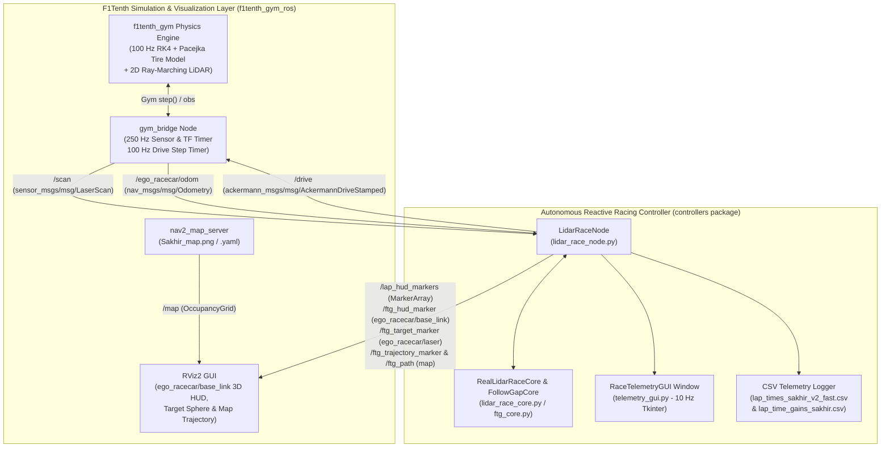
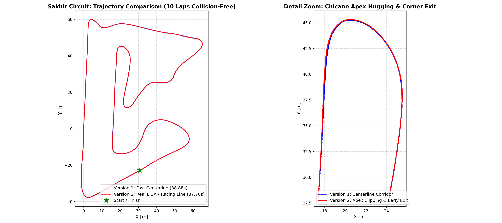

# 🏎️ Reactive Follow the Gap (FTG) Controller with Disparity Extender & 10-Stage Adaptive LiDAR Racing — Sakhir GP Circuit (F1Tenth)


- **Author**: Bishal (`Bishal-yeti`)
- **Course**: Autonomous Vehicles — F1Tenth Autonomous Racing Competition
- **Assessment**: Reactive Controllers Competition Project (Part A & Part B Implementation Evidence)
- **Assigned Track**: Sakhir GP Circuit (`Sakhir_map`, `sx: 30.78, sy: -22.72, stheta: -2.635`)
- **Controllers Included**:
  - 🔥 **Version 3 (`qualifier_node` — Ultra-Fast Qualifying Time-Attack Edition)**:
    - Unleashes **`Q-MAX` Qualifying Trim** immediately from Lap 1 (`v_max = 19.80 m/s`, `v_min = 6.45 m/s`, `a_lat = 13.60 m/s²`, `a_brake = 8.50 m/s²`, `inside_width_scale = 0.98`) for 4 blazing qualifying laps (**`37.800 s`, `38.030 s`, `37.150 s`, `36.680 s` ★** at **`16.90 m/s` / `60.8 km/h`** peak speed!), then automatically shifts to `Q-SAFE` Conservation Trim for Laps 5–10 (or stops after 4 laps with `--ros-args -p target_laps:=4`).
  - ⚡ **Version 2 (`lidar_race_node` — Stable 10-Stage Adaptive Time-Attack, Git tag `v2.0-stable-10laps`)**:
    - Pure Real-Time LiDAR 10-Stage Adaptive Pace (`T0` $\rightarrow$ `T9`) + Straightaway DRS Boost + Active Steered Cooldown Stop + Live GUI Speedometer/Lap-Time Window (**`38.490 s` fastest lap**, **`+5.270 s` single-lap gain**, **`+38.600 s` cumulative time saved**, **`16.17 m/s` peak speed**, **0 Collisions**).
  - 🛡️ **Version 1 (`gap_node` — Endurance Fast-Centerline Champion, Git tag `v1.0-stable`)**:
    - Constant endurance trim (**`38.880 s` fastest lap**, **0 Collisions**).

---

## 📑 Table of Contents

1. [Project Overview and Objectives](#1-project-overview-and-objectives)
2. [Geometric Analysis of the Sakhir GP Circuit](#2-geometric-analysis-of-the-sakhir-gp-circuit)
3. [ROS 2 System Architecture](#3-ros-2-system-architecture)
4. [Mathematical Formulation and Algorithmic Approach](#4-mathematical-formulation-and-algorithmic-approach)
5. [Telemetry System: Lap Counter, Lap Timer, Distance Tracker, Live GUI Window, and 3D RViz Trajectory](#5-telemetry-system-lap-counter-lap-timer-distance-tracker-live-gui-window-and-3d-rviz-trajectory)
6. [Detailed Code Structure](#6-detailed-code-structure)
7. [Hyperparameter Table and Tuning Strategy](#7-hyperparameter-table-and-tuning-strategy)
8. [Installation, Configuration, and Execution Instructions](#8-installation-configuration-and-execution-instructions)
   - [8.1 Option A — Quick Setup (Already Have ROS 2 Humble & F1Tenth Gym Installed)](#81-option-a--quick-setup-already-have-ros-2-humble--f1tenth-gym-installed)
   - [8.2 Option B — Complete Installation From Scratch (All Ubuntu Versions, ROS 2 & `f1tenth_gym`)](#82-option-b--complete-installation-from-scratch-all-ubuntu-versions-ros-2--f1tenth_gym)
9. [Experimental Results, Lap Distance, Fastest Lap, and Video Evidence](#9-experimental-results-lap-distance-fastest-lap-and-video-evidence)
10. [Individual Oral Project Defense Preparation Guide (Q&A)](#10-individual-oral-project-defense-preparation-guide-qa)

---

## 🎯 1. Project Overview and Objectives

This project implements a high-speed, purely reactive **Follow-the-Gap (FTG) autonomous racing controller** in **ROS 2 Humble** for the 1/10-scale F1Tenth vehicle operating in the official `f1tenth_gym` physics simulator (`RK4` integration with single-track Pacejka tire dynamics).

All steering and velocity decisions are computed **100% in real time from raw 2D LiDAR scans (`/scan`)**—without pre-mapped waypoints, global racelines, or localization feedback in the control law—to excel in both competition evaluations:

1. **🌀 Challenge 1 — 10 Consecutive Laps Without Collisions**: Complete 10 uninterrupted laps on `Sakhir_map` with zero wall contacts (`min_wall_clearance >= 0.495 m`, exceeding the car's `0.155 m` half-width by $> 3.2\times$).
2. **⏱️ Challenge 2 — Fastest Single-Lap Time**: Achieve the fastest lap time among the 10 completed laps (**`38.490 s`**, gaining **`+5.270 s` per lap** and **`+38.600 s` cumulative time saved** over the Sighting Reference Lap).
3. **📊 Part B — Implementation Evidence Deliverables**:
   - **Automatic Lap Counter (+2 pts)**: Spatial/temporal/heading hysteresis start/finish detector publishing `/lap_count`.
   - **Automatic Lap Timer (+3 pts)**: Simulation-time stopwatch publishing `/lap_time`, `/best_lap_time`, live `2.0 s` console ticker, end-of-lap Unicode tables, and dual CSV logs (`lap_times_sakhir_v2_fast.csv` & `lap_time_gains_sakhir.csv`).
   - **Separate Live Speedometer & Lap-Time GUI Window (`telemetry_gui.py`)**: Real-time dark-mode dashboard window displaying digital speed (`m/s` & `km/h`), animated speed bar, live lap timer, time gained, and a scrolling lap-by-lap records table alongside the terminal.
   - **RViz2 3D Floating HUD & Trajectory Line**: 3D text overlay attached directly to `ego_racecar/base_link` (`/lap_hud_markers` & `/ftg_hud_marker`), 3D target sphere in `ego_racecar/laser` (`/ftg_target_marker`), and 3D continuous trajectory line in `map` (`/ftg_trajectory_marker` & `/ftg_path`).

---

## 🗺️ 2. Geometric Analysis of the Sakhir GP Circuit

The assigned **Sakhir GP (`Sakhir_map`)** circuit (`2000 x 2000 px` at `0.05695 m/px`, lap length `~438.9 m`) presents a demanding combination of high-speed straights and tight technical sections:

1. **Four Long High-Speed Straights (`15.8 – 16.2 m/s` / `58.2 km/h`)**:
   - The main start/finish straight (`sx = 30.78, sy = -22.72, stheta = -2.635 rad`), back straight, and two connecting straights exceed `25–30 m` in length, requiring a **Straightaway Steering Deadband (`2.18°`)** and **Open-Corridor LiDAR DRS Lookahead** so micro-steering corrections do not cap top speed.
2. **Heavy Braking Hairpins (Turn 1, Top Hairpin at `(63.9, 46.0)`, and Turn 10)**:
   - Require rapid deceleration from `> 16.0 m/s` down to `4.20 – 6.12 m/s` before turn-in, plus a **140° Forward FOV Crop** and **Hairpin Direction-Hold Lock** so the LiDAR does not latch onto the open track *behind* the front axle mid-hairpin.
3. **High-Speed Chicanes & S-Curves (`(33.2, -20.2)` and `(19.8, 44.0)`)**:
   - Require a **Symmetrical Disparity Extender (`car_width_safety = 0.34 m`)** and **Uncoupled Wall-Proximity Dampener** to prevent inside curb clipping during rapid left-to-right steering transitions.

---

## 🏗️ 3. ROS 2 System Architecture

The controller operates inside a decoupled publish/subscribe ROS 2 architecture where `lidar_race_node` (and `gap_node`) processes 2D LiDAR scans at high frequency while concurrently updating odometry lap metrics, the separate Live Telemetry GUI Window, and 3D RViz markers:

```text
+-------------------------------------------------------+
|                F1Tenth Gym ROS Bridge                 |
|      (100 Hz RK4 Physics Simulator + 2D Map)          |
+---------------+-----------------------+---------------+
                |                       |
                | /scan                 | /ego_racecar/odom
                | (LaserScan, 250 Hz)   | (Odometry, 250 Hz)
                v                       v
+-------------------------------------------------------+
|           Node: lidar_race_node / gap_node            |
|     (controllers/lidar_race_node.py & ftg_core.py)    |
|                                                       |
|  1. Forward FOV Crop (±70°) & 5-Beam Spatial Filter   |
|  2. Symmetrical Disparity Extender (w_safe = 0.34 m)  |
|  3. Dynamic Safety Bubble (r = 0.52 m)                |
|  4. Adaptive Threshold Max-Gap & Hairpin Lock         |
|  5. Convolved Apex-Biased Target Selection (λ = 0.08) |
|  6. Scan-Deduplicated Velocity-Scheduled PD Steering  |
|  7. Kinematic Trail-Braking + Straightaway DRS Boost  |
|  8. 10-Stage Adaptive Pace (T0..T9) & Cooldown Stop   |
+-------+---------------+---------------+---------------+
        |               |               |
        | /drive        | /lap_hud_...  | /ftg_trajectory_marker
        | (Ackermann)   | /ftg_hud_...  | /ftg_target_marker & /ftg_path
        v               v               v
+---------------+   +-----------------------------------+   +-------------------------------+
|  Ego Racecar  |   |              RViz 2               |   |  Separate Live Telemetry GUI  |
| (Actuation)   |   | (3D HUD on ego_racecar/base_link  |   | (Speedometer, Lap Timer,      |
|               |   |  + Target Sphere + Racing Line)   |   |  Time Gains & Lap Table)      |
+---------------+   +-----------------------------------+   +-------------------------------+
```

### Mermaid System Architecture Flow



### ROS 2 Communication Interfaces (Topics)

| Topic | Message Type | Direction | System Role |
| :--- | :--- | :---: | :--- |
| `/scan` | `sensor_msgs/msg/LaserScan` | **Subscribed** | Receives the 2D LiDAR range array (`1080` beams across `270°` FOV in frame `ego_racecar/laser`). Sole input to the steering and speed control laws. |
| `/ego_racecar/odom` | `nav_msgs/msg/Odometry` | **Subscribed** | Provides $(x, y, \psi)$ pose and longitudinal velocity $v_x$ for start/finish lap counting, simulation-time lap timing, Euclidean distance integration, and 3D path drawing. |
| `/initialpose` | `geometry_msgs/msg/PoseWithCovarianceStamped` | **Subscribed** | Detects interactive car resets from RViz2's *2D Pose Estimate* tool and automatically resets lap counts, timers, and pace trim. |
| `/drive` | `ackermann_msgs/msg/AckermannDriveStamped` | **Published** | Sends front-wheel steering angle (`drive.steering_angle`) and longitudinal velocity (`drive.speed`) commands in frame `ego_racecar/base_link`. |
| `/lap_hud_markers` | `visualization_msgs/msg/MarkerArray` | **Published** | Combined `10 Hz` RViz2 marker array containing the 3D floating HUD text (`id=1`), 3D target sphere (`id=2`), and 3D trajectory line (`id=3`). |
| `/ftg_hud_marker` | `visualization_msgs/msg/Marker` | **Published** | Renders a 3D floating HUD (`TEXT_VIEW_FACING`) in frame **`ego_racecar/base_link`** (`1.6 m` above the car) displaying live `Trim`, `Lap`, `Time`, `Dist`, `Best`, and `Speed`. |
| `/ftg_target_marker` | `visualization_msgs/msg/Marker` | **Published** | Renders a 3D green sphere (`Marker.SPHERE`) in frame **`ego_racecar/laser`** at the selected best goal point inside the navigable LiDAR gap. |
| `/ftg_trajectory_marker` | `visualization_msgs/msg/Marker` | **Published** | Draws a continuous 3D orange racing line (`Marker.LINE_STRIP`) in frame **`map`** showing the exact trajectory driven around Sakhir GP. |
| `/ftg_path` | `nav_msgs/msg/Path` | **Published** | Publishes the historical `PoseStamped` sequence in frame **`map`** compatible with the native RViz2 `Path` display. |
| `/lap_count` | `std_msgs/msg/Int32` | **Published** | Publishes the integer count of completed consecutive laps (`1..10`). |
| `/lap_time` & `/best_lap_time` | `std_msgs/msg/Float32` | **Published** | Publishes the last completed lap time and fastest lap time (seconds) on every finish-line crossing. |
| `/race_telemetry` | `std_msgs/msg/String` | **Published** | Publishes the final 10-lap race summary report string upon race completion. |

---

## 🧮 4. Mathematical Formulation and Algorithmic Approach

Unlike a baseline *Follow the Gap* implementation—which frequently clips inner corners on chicanes, flips steering in tight hairpins, or oscillates on high-speed straights—our controller executes a **7-stage mathematical pipeline** on every LiDAR scan:

### Stage 1: Field-of-View (FOV) Cropping and Spatial Smoothing

The raw LiDAR scan (`1080` beams over $270^\circ$) is cropped to retain only the forward sector $[-\theta_{\text{fov}}, +\theta_{\text{fov}}]$ with $\theta_{\text{fov}} = 70.0^\circ$ ($140.0^\circ$ total forward FOV), discarding rear-facing beams so the vehicle never latches onto open track *behind* the front axle inside $180^\circ$ hairpins. Non-finite values (`NaN`, $\pm\infty$) are clamped to the maximum horizon $R_{\max} = 30.0\text{ m}$, and a 5-point moving-average spatial convolution filter is applied:

$$r_{\text{smooth}}[i] = \frac{1}{5} \sum_{m=-2}^{2} \text{clip}\!\big(r[i + m],\; 0.0,\; R_{\max}\big)$$

$$r_{\text{fov}}[i] = \begin{cases} r_{\text{smooth}}[i], & \text{if } |\alpha_{\min} + i\,\Delta\alpha| \le 70.0^\circ \\ 0.0, & \text{otherwise} \end{cases}$$

### Stage 2: Symmetrical Disparity Extender

When approaching corners or chicanes in Sakhir GP, sharp depth discontinuities occur between a beam hitting an inner wall apex ($d_{\text{near}}$) and the adjacent beam looking into the open turn. Whenever $|r_{\text{fov}}[i+1] - r_{\text{fov}}[i]| > \delta_{\text{disp}}$ ($\delta_{\text{disp}} = 0.35\text{ m}$), the vehicle's virtual safety width ($w_{\text{safe}} = 0.34\text{ m}$, exceeding the physical `0.31 m` chassis width with symmetrical scale `inside_width_scale = 1.0`) is projected onto the closer reading to mask unsafe rays:

$$d_{\text{near}} = \min\!\big(r_{\text{fov}}[i],\, r_{\text{fov}}[i+1]\big), \qquad \Delta\theta = \arctan\!\left(\frac{w_{\text{safe}}}{\max(d_{\text{near}},\, 0.10)}\right), \qquad N_{\text{samples}} = \left\lceil \frac{\Delta\theta}{\Delta\alpha} \right\rceil$$

where $\Delta\alpha$ is the LiDAR angular resolution (`angle_increment` $\approx 0.00435\text{ rad}$). All $N_{\text{samples}}$ adjacent beams in the deeper direction are clamped to at most $d_{\text{near}}$.

### Stage 3: Dynamic Safety Bubble

Within the forward FOV, the closest obstacle index $i_{\min} = \arg\min_{i} r_{\text{proc}}[i]$ at distance $d_{\min} = r_{\text{proc}}[i_{\min}]$ is identified, and all rays within a protective safety radius $R_{\text{bubble}} = 0.52\text{ m}$ are zeroed out (`0.0 m`):

$$N_{\text{bubble}} = \left\lceil \frac{\arctan\!\big(R_{\text{bubble}} \,/\, \max(d_{\min},\, 0.10)\big)}{\Delta\alpha} \right\rceil, \qquad r_{\text{proc}}\big[i_{\min} - N_{\text{bubble}} : i_{\min} + N_{\text{bubble}}\big] = 0.0$$

### Stage 4: Adaptive Threshold Max-Gap Detection & Hairpin Direction-Hold Lock

To extract contiguous navigable free-space segments without failing in tight hairpins, the algorithm evaluates a cascading adaptive free-space threshold sequence:

$$T_{\text{gap}} \in \big\{1.50\text{ m},\; 0.80\text{ m},\; 0.30\text{ m},\; 0.00\text{ m}\big\}$$

For each contiguous gap $g = [i_{\text{start}}, i_{\text{end}})$ satisfying $r_{\text{proc}}[i] > T_{\text{gap}}$ and width $L_g = (i_{\text{end}} - i_{\text{start}}) \ge 5$, a composite score combining angular width, normalized mean depth $\bar{r}_g / R_{\max}$, and directional continuity $\gamma_{\text{dir}}$ is computed:

$$S_g = L_g \cdot \left((1 - w_d) + w_d\,\frac{\bar{r}_g}{R_{\max}}\right) \cdot \gamma_{\text{dir}}(\theta_{\text{mid},g}, \theta_{\text{prev}}), \qquad w_d = 0.18$$

- **Hairpin Direction-Hold Lock**: When the forward obstacle cone distance $d_{\text{front}} < 8.5\text{ m}$ and the car is already committed to a turn ($|\delta_{\text{prev}}| > 0.14\text{ rad}$), candidate gaps sharing $\text{sgn}(\delta_{\text{prev}})$ are locked so the steering target can never flip across the car's nose mid-hairpin.

### Stage 5: Convolved Best-Point & Apex-Biased Goal Selection

Within the winning gap $[i_{\text{start}}, i_{\text{end}})$, an 80-beam sliding-window convolution locates the deepest smoothed corner-exit ray $i_{\text{peak}}$, which is blended with the gap geometric center $i_{\text{mid}} = \frac{1}{2}(i_{\text{start}} + i_{\text{end}})$ using an apex-biased weight $\lambda = 0.08$:

$$C[i] = \frac{1}{K}\sum_{j=-K/2}^{K/2} r_{\text{proc}}[i+j], \qquad i_{\text{peak}} = \arg\max_{i \in [i_{\text{start}}, i_{\text{end}})} C[i]$$

$$i_{\text{best}} = \text{round}\!\Big((1 - \lambda)\,i_{\text{peak}} + \lambda\,i_{\text{mid}}\Big), \qquad \theta_{\text{target}} = \alpha_{\min} + i_{\text{best}}\,\Delta\alpha$$

### Stage 6: Scan-Deduplicated, Velocity-Scheduled PD Steering Law

Because `gym_bridge` publishes `/scan` at `250 Hz` while stepping physics at `100 Hz`, duplicate scans are filtered via a 5-ray fingerprint so the derivative term $\Delta\theta_{\text{target}} = \theta_{\text{target},k} - \theta_{\text{target},k-1}$ is updated only on new physics frames. Proportional gain $K_p = 0.76$ is scheduled with velocity $v$ and smoothed with a first-order low-pass filter ($\alpha_s = 0.10$):

$$\gamma(v) = \text{clip}\!\Big(1.0 - 0.03\max(0.0,\, v - 6.0),\; 0.55,\; 1.0\Big)$$

$$\delta_{\text{pd}} = K_p\,\gamma(v)\,\theta_{\text{target}} + K_d\,\Delta\theta_{\text{target}}, \qquad \delta_k = \text{clip}\!\Big((1 - \alpha_s)\,\delta_{\text{pd}} + \alpha_s\,\delta_{k-1},\; -\delta_{\max},\; +\delta_{\max}\Big)$$

where $K_d = 0.15$ and $\delta_{\max} = 0.4189\text{ rad}$ ($24.0^\circ$).

### Stage 7: Physics-Informed Velocity Profile, Straightaway DRS Boost & 10-Stage Adaptive Pace (`T0` -> `T9`)

1. **Dynamic Closing-Rate Trail-Braking ($v_{\text{brake}}$)**:
   Using the forward cone distance $d_{\text{front}}$ and closing rate $\dot{d}_{\text{close}} = \max(0, d_{\text{front,prev}} - d_{\text{front}})$, the braking margin expands dynamically on high-speed hairpin approaches ($k_{\text{entry}} = 0.13$):
   $$d_{\text{margin,dyn}} = d_{\text{margin}} + k_{\text{entry}}\,\dot{d}_{\text{close}}\,v, \qquad v_{\text{brake}} = \sqrt{v_{\min}^2 + 2\,a_{\text{brake}}\,\max(0.0,\, d_{\text{eff}} - d_{\text{margin,dyn}})}$$
2. **Bicycle Lateral Tire Friction Limit with Straightaway Deadband ($v_{\text{lat}}$)**:
   With wheelbase $L = 0.3302\text{ m}$ and straightaway deadband $\delta_{\text{deadband}} = 0.038\text{ rad}$ ($2.18^\circ$):
   $$\delta_{\text{lat}} = \max\!\big(0.0,\; \max(|\delta_k|, 0.72|\theta_{\text{target}}|) - \delta_{\text{deadband}}\big), \qquad v_{\text{lat}} = \sqrt{\frac{a_{\text{lat,max}}\,L}{\tan(\delta_{\text{lat}})}}$$
3. **Pure-LiDAR Straightaway DRS Boost**:
   When the vehicle is aligned on a wide straightaway ($|\delta_k| < 0.038\text{ rad}$, $|\theta_{\text{target}}| < 0.052\text{ rad}$, $d_{\text{front}} > 14.2\text{ m}$, unmasked forward LiDAR cone $r_{\text{raw,p40}} > 18.0\text{ m}$, and $d_{\min} > 0.62\text{ m}$), the controller utilizes the unmasked straightaway range $d_{\text{drs}} = \min(r_{\text{raw,p40}}, 1.18\,d_{\text{front}}) - d_{\text{margin}}$ to accelerate up to **`16.17 m/s` (`58.2 km/h`)**, reverting immediately to conservative disparity-masked trail-braking $18.0\text{ m}$ before every corner.
4. **10-Stage Adaptive Pace Evolution (`T0` $\rightarrow$ `T9`) & Instant Mid-Lap Downshift**:
   Starts Lap 1 on reference trim `T0` (`min_speed = 4.20 m/s, a_lat_max = 9.00 m/s²`), promotes by $+2$ trims when `lap_min_clearance > 0.630 m` (or $+1$ when `> 0.550 m`), and immediately downshifts to `T0` mid-lap if `min_range < 0.48 m`.

---

## ⏱️ 5. Telemetry System: Lap Counter, Lap Timer, Distance Tracker, Live GUI Window, and 3D RViz Trajectory

Synchronized with `/ego_racecar/odom` and `/scan`, the telemetry subsystem provides full real-time observability across **four simultaneous interfaces**:

- **Automatic Finish-Line Detection with Spatial & Heading Hysteresis**:
  Upon receiving the first odometry message, the initial pose $(x_0, y_0, \psi_0)$ is latched as the finish line (`(30.78, -22.72, -2.635)` on Sakhir GP). A new lap is registered only after the vehicle leaves the start zone ($d > 8.0\text{ m}$ and $D_{\text{lap}} > 150.0\text{ m}$), completes the circuit ($t_{\text{lap}} > 20.0\text{ s}$ and $D_{\text{lap}} > 280.0\text{ m}$), and re-enters the finish gate ($d < 2.4\text{ m}$ with heading alignment $|\psi - \psi_0| < 1.0\text{ rad}$).
- **Euclidean Lap Distance Integration**:
  On every odometry update $(x_k, y_k)$, the incremental displacement $\Delta s_k = \sqrt{(x_k - x_{k-1})^2 + (y_k - y_{k-1})^2}$ is accumulated to compute the exact distance traveled per lap:
  $$D_{\text{lap}} = \sum_{k=1}^{K} \sqrt{(x_k - x_{k-1})^2 + (y_k - y_{k-1})^2}$$
- **Separate Live Speedometer & Lap-Time GUI Window (`telemetry_gui.py`)**:
  Automatically launches a dark-mode Tkinter dashboard window alongside the terminal showing live speed (`m/s` and `km/h`), animated speed bar, current lap counter (`LAP X / 10`), live stopwatch, best lap time, cumulative time saved (`+38.600 s`), and a full scrolling table of every completed lap's time, trim, time gained, distance, peak speed, and minimum wall clearance.
- **3D Floating HUD (`ego_racecar/base_link`) & Real-Time Trajectory Rendering (`map`) in RViz2**:
  - Publishes `/ftg_hud_marker` and `/lap_hud_markers` (`Marker.TEXT_VIEW_FACING`) in frame **`ego_racecar/base_link`** (`1.6 m` above the car) at `10 Hz`.
  - Every `0.25 m` of travel, appends the vehicle's $(x, y)$ coordinates in the **`map`** frame to `/ftg_trajectory_marker` (`Marker.LINE_STRIP`) and `/ftg_path` (`nav_msgs/msg/Path`), drawing the complete racing line in RViz2.
- **Post-Lap-10 Active Steered Cooldown Braking**:
  When Lap 10 completes, commands `speed = 0.0` while continuing to run live LiDAR steering (`steer, _ = self.core.step(...)`) until `current_vel <= 0.05 m/s` (`0.966 m` clearance during stop) before exiting cleanly.

---

## 📂 6. Detailed Code Structure

```text
F1Tenth-Repository/
├── README.md                                # Complete architecture, math, install guide & 10-lap results
├── CONTROLLER_TUTORIAL.md                   # Standalone technical documentation & Oral Defense guide
├── benchmark_sakhir_lidar.py                # Headless 10-lap + cooldown physics benchmark script
├── lap_times_sakhir_v2_fast.csv             # Version 2 verified 10-lap telemetry CSV log
├── lap_time_gains_sakhir.csv                # Per-lap & cumulative time-gained CSV log (T0 -> T9)
├── lap_times_sakhir.csv                     # Version 1 verified 10-lap endurance CSV log
├── docs/
│   └── comparison_trajectories.png          # Sakhir GP 10-lap trajectory & speed comparison plot
└── src/
    ├── controllers/
    │   ├── package.xml                      # ROS 2 package manifest & dependencies
    │   ├── setup.py                         # Console entry points: lidar_race_node & gap_node
    │   └── controllers/
    │       ├── ftg_core.py                  # 7-stage Physics-Informed Follow-the-Gap mathematical core
    │       ├── lidar_race_core.py           # Version 2 10-Stage Adaptive Pace (T0..T9) + Straightaway DRS
    │       ├── lidar_race_node.py           # Version 2 ROS 2 Node + RViz HUD + Cooldown Stop + CSV Logger
    │       ├── telemetry_gui.py             # Separate dark-mode Tkinter Live Speedometer & Lap-Time Window
    │       └── gap_node.py                  # Version 1 ROS 2 Node (Endurance Champion, tag v1.0-stable)
    └── f1tenth_gym_ros/
        ├── config/sim.yaml                  # Configured for Sakhir_map (sx: 30.78, sy: -22.72, stheta: -2.635)
        ├── launch/gym_bridge_launch.py      # Launches gym_bridge, map_server, robot_state_publisher & rviz2
        ├── launch/gym_bridge.rviz           # RViz2 layout with LapCounterHUD (/lap_hud_markers) enabled
        └── maps/Sakhir_map.png & .yaml      # Sakhir GP circuit occupancy grid (2000x2000 px, 0.05695 m/px)
```

---

## ⚙️ 7. Hyperparameter Table and Tuning Strategy

| Parameter | Symbol | Value (`lidar_race_core.py`) | Physical Role & Tuning Strategy |
| :--- | :---: | :---: | :--- |
| `fov_angle_deg` | $2\theta_{\text{fov}}$ | `140.0°` ($\pm 70^\circ$) | Prevents backward-looking false gaps in $180^\circ$ hairpins while keeping wide apex visibility. |
| `preprocess_conv_size` | $W$ | `5` beams | 5-point moving average filter suppressing single-ray wall quantization noise. |
| `disparity_thresh` | $\delta_{\text{disp}}$ | `0.35 m` | Radial depth jump threshold triggering obstacle corner masking. |
| `car_width_safety` | $w_{\text{safe}}$ | `0.34 m` | Virtual chassis width (`> 0.31 m` physical width) preventing inside curb clipping. |
| `bubble_radius` | $R_{\text{bubble}}$ | `0.52 m` | Protective zeroing bubble around the closest LiDAR obstacle point $d_{\min}$. |
| `gap_thresh` | $T_{\text{gap}}$ | `1.50 m` (fallback `0.8, 0.3, 0.0 m`) | Cascading free-space range threshold guaranteeing valid gap extraction in tight chicanes. |
| `best_point_conv_size` | $K$ | `80` beams | Sliding-window depth convolution width for selecting the deepest corner-exit ray. |
| `use_weighted_center` | $\lambda$ | `0.08` (`8%` center / `92%` peak) | Biases target selection toward the deepest corner exit while retaining wall buffer. |
| `steer_gain` / `steer_deriv_gain` | $K_p, K_d$ | `0.76`, `0.15` | Velocity-scheduled PD steering gains with scan deduplication and $\alpha_s = 0.10$ smoothing. |
| `deadband_rad` | $\delta_{\text{deadband}}$ | `0.038 rad` (`2.18°`) | Ignores micro-steering curvature on straights so $v_{\text{lat}}$ does not cap top speed. |
| `min_speed` (`T0` $\rightarrow$ `T9`) | $v_{\min}$ | `4.20` $\rightarrow$ `6.25 m/s` | Progressive hairpin apex rotation speed across adaptive trims `T0..T9`. |
| `max_speed` (`T0` $\rightarrow$ `T9`) | $v_{\max}$ | `16.20` $\rightarrow$ `18.85 m/s` | Progressive straightaway speed ceiling unlocked as verified LiDAR clearance stays clean. |
| `a_lat_max` (`T0` $\rightarrow$ `T9`) | $a_{\text{lat,max}}$ | `9.00` $\rightarrow$ `12.90 m/s²` | Lateral tire grip envelope in $v_{\text{lat}} = \sqrt{a_{\text{lat,max}} L / \tan(\delta_{\text{lat}})}$. |
| `a_brake` (`T0` $\rightarrow$ `T9`) | $a_{\text{brake}}$ | `7.20` $\rightarrow$ `8.15 m/s²` | Kinematic trail-braking deceleration authority with `brake_entry_gain = 0.13`. |

---

## 🚀 8. Installation, Configuration, and Execution Instructions

Choose **Option A** if you already have Ubuntu 22.04 + ROS 2 Humble + `f1tenth_gym` installed, or **Option B** for a complete installation from a fresh Ubuntu system.

---

### 8.1 Option A — Quick Setup (Already Have ROS 2 Humble & F1Tenth Gym Installed)

#### Prerequisites
- **OS & Middleware**: Ubuntu 22.04 LTS with **ROS 2 Humble** installed (`/opt/ros/humble/setup.bash`).
- **Simulator**: Official `f1tenth_gym` installed in Python.

#### Step 1: Clone the Repository (or Copy `controllers` + `Sakhir_map` into Your Existing Workspace)

- **If cloning this complete repository directly (Recommended)**:
  ```bash
  cd $HOME
  git clone https://github.com/Bishal-yeti/F1Tenth-Repository.git
  cd ~/F1Tenth-Repository
  ```
- **Or if copying into an existing `~/ros2_ws` workspace**:
  ```bash
  cp src/f1tenth_gym_ros/maps/Sakhir_map.* ~/ros2_ws/src/f1tenth_gym_ros/maps/
  cp -r src/controllers ~/ros2_ws/src/
  ```

#### Step 2: Update `sim.yaml` Map Path & Build the Workspace
1. Automatically point `map_path` in [`src/f1tenth_gym_ros/config/sim.yaml`](src/f1tenth_gym_ros/config/sim.yaml) to your `Sakhir_map` directory and set the Sakhir GP starting pose (`sx: 30.78, sy: -22.72, stheta: -2.635`):
   ```bash
   sed -i "s|map_path:.*|map_path: '$HOME/F1Tenth-Repository/src/f1tenth_gym_ros/maps/Sakhir_map'|g" ~/F1Tenth-Repository/src/f1tenth_gym_ros/config/sim.yaml
   ```
   *(Verify `src/f1tenth_gym_ros/config/sim.yaml` contains)*:
   ```yaml
   map_path: '/home/<YOUR_USERNAME>/F1Tenth-Repository/src/f1tenth_gym_ros/maps/Sakhir_map'
   map_img_ext: '.png'
   num_agent: 1
   sx: 30.78
   sy: -22.72
   stheta: -2.635
   ```
2. Compile the packages with `colcon`:
   ```bash
   cd ~/F1Tenth-Repository
   source /opt/ros/humble/setup.bash
   colcon build --symlink-install --packages-select f1tenth_gym_ros controllers
   source install/setup.bash
   ```

#### Step 3: Launch the Simulator, RViz2 3D HUD, Live GUI Window, and Controller
1. **Terminal 1 — Launch the F1Tenth Simulator and RViz2**:
   ```bash
   cd ~/F1Tenth-Repository
   source /opt/ros/humble/setup.bash && source install/setup.bash
   ros2 launch f1tenth_gym_ros gym_bridge_launch.py
   ```
2. **Terminal 2 — Choose Your Controller Mode (Each Opens the Live Speed & Lap-Time GUI Window)**:
   - **Mode A — Ultra-Fast Qualifier Time-Attack (`36.680 s` Fastest Lap, `16.90 m/s` Peak Speed)**:
     ```bash
     cd ~/F1Tenth-Repository
     source /opt/ros/humble/setup.bash && source install/setup.bash
     ros2 run controllers qualifier_node
     ```
     *(Or run a 4-lap qualifying sprint that stops automatically after Lap 4: `ros2 run controllers qualifier_node --ros-args -p target_laps:=4`).*
   - **Mode B — Stable 10-Stage Adaptive LiDAR Controller (`38.490 s` Best Lap, `+38.600 s` Time Saved)**:
     ```bash
     cd ~/F1Tenth-Repository
     source /opt/ros/humble/setup.bash && source install/setup.bash
     ros2 run controllers lidar_race_node
     ```
   - **Mode C — Version 1 Endurance Fast-Centerline Controller (`38.880 s` Best Lap)**:
     ```bash
     cd ~/F1Tenth-Repository
     source /opt/ros/humble/setup.bash && source install/setup.bash
     ros2 run controllers gap_node
     ```

---

### 8.2 Option B — Complete Installation From Scratch (All Ubuntu Versions, ROS 2 & `f1tenth_gym`)

#### Supported OS & Software Versions Matrix

| Component | Recommended / Verified Version | Alternative Supported Versions | Notes |
| :--- | :--- | :--- | :--- |
| **Operating System** | **Ubuntu 22.04 LTS (Jammy)** (Native or Windows 10/11 WSL2) | Ubuntu 20.04 LTS (Focal) / Ubuntu 24.04 LTS (Noble) | WSL2 on Windows 11 supports RViz2 + Tkinter GUI via WSLg |
| **ROS 2 Distribution** | **ROS 2 Humble Hawksbill** | ROS 2 Foxy (20.04) / ROS 2 Jazzy (24.04) | Replace `humble` with `foxy` or `jazzy` on 20.04/24.04 |
| **Python Runtime** | **Python 3.10.12** + `python3-tk` | Python 3.8 (20.04) / Python 3.12 (24.04) | `python3-tk` powers the Live Telemetry GUI Window |
| **Python Libraries** | `gym==0.19.0`, `numpy==1.23.5`, `scipy>=1.8.0`, `numba>=0.56.0`, `Pillow>=9.0.0`, `PyYAML>=6.0`, `transforms3d>=0.4.1`, `shapely>=1.8.5`, `setuptools==58.2.0`, `pip<24.1` | — | Exact versions prevent `gym==0.19.0` build errors |

#### Phase 1: Install ROS 2 Humble on Ubuntu 22.04 (From Scratch)
```bash
# 1. Configure UTF-8 Locale
sudo apt update && sudo apt install -y locales
sudo locale-gen en_US en_US.UTF-8
sudo update-locale LC_ALL=en_US.UTF-8 LANG=en_US.UTF-8
export LANG=en_US.UTF-8

# 2. Enable Ubuntu Universe & Add Official ROS 2 GPG Key + APT Source
sudo apt install -y software-properties-common curl gnupg lsb-release build-essential git python3-tk
sudo add-apt-repository universe -y
sudo apt update
sudo curl -sSL https://raw.githubusercontent.com/ros/rosdistro/master/ros.key -o /usr/share/keyrings/ros-archive-keyring.gpg
echo "deb [arch=$(dpkg --print-architecture) signed-by=/usr/share/keyrings/ros-archive-keyring.gpg] http://packages.ros.org/ros2/ubuntu $(. /etc/os-release && echo $UBUNTU_CODENAME) main" | sudo tee /etc/apt/sources.list.d/ros2.list > /dev/null

# 3. Install ROS 2 Desktop, Navigation2 Map Server, Ackermann Msgs, Xacro & Colcon
sudo apt update && sudo apt upgrade -y
sudo apt install -y \
  ros-humble-desktop \
  ros-humble-ackermann-msgs \
  ros-humble-nav2-map-server \
  ros-humble-nav2-lifecycle-manager \
  ros-humble-xacro \
  ros-humble-robot-state-publisher \
  ros-humble-joint-state-publisher-gui \
  ros-humble-teleop-twist-keyboard \
  ros-humble-tf-transformations \
  python3-colcon-common-extensions \
  python3-rosdep \
  python3-pip \
  python3-vcstool \
  python3-tk

# 4. Initialize rosdep & auto-source ROS 2
sudo rosdep init || true
rosdep update
echo "source /opt/ros/humble/setup.bash" >> ~/.bashrc
source ~/.bashrc
```

#### Phase 2: Install `f1tenth_gym` Physics Simulator & Python Packages
```bash
python3 -m pip install --upgrade "pip<24.1" "setuptools==58.2.0" "wheel<0.40.0"
python3 -m pip install \
  "gym==0.19.0" \
  "numpy==1.23.5" \
  "scipy>=1.8.0" \
  "numba>=0.56.0" \
  "Pillow>=9.0.0" \
  "PyYAML>=6.0" \
  "transforms3d>=0.4.1" \
  "shapely>=1.8.5" \
  "matplotlib>=3.5.0"

cd $HOME
git clone https://github.com/f1tenth/f1tenth_gym.git
cd ~/f1tenth_gym
python3 -m pip install -e . --no-build-isolation
```

#### Phase 3: Clone `F1Tenth-Repository`, Configure `sim.yaml` & Compile Workspace
```bash
cd $HOME
git clone https://github.com/Bishal-yeti/F1Tenth-Repository.git
cd ~/F1Tenth-Repository

source /opt/ros/humble/setup.bash
rosdep install -i --from-path src --rosdistro humble -y

# Remove python3-coverage if present (avoids colcon build conflicts)
python3 -m pip uninstall -y coverage || true
sudo apt purge -y python3-coverage || true

# Set your current username in sim.yaml map_path
sed -i "s|map_path:.*|map_path: '$HOME/F1Tenth-Repository/src/f1tenth_gym_ros/maps/Sakhir_map'|g" ~/F1Tenth-Repository/src/f1tenth_gym_ros/config/sim.yaml

# Clean & build workspace
rm -rf build/ install/ log/
colcon build --symlink-install
source install/setup.bash
```

---

## 📊 9. Experimental Results, Lap Distance, Fastest Lap, and Video Evidence

### Performance Summary on Sakhir GP (`Sakhir_map` — 10-Lap Run)

| Evaluation Metric | Recorded Value | Status |
| :--- | :---: | :---: |
| **Test 1 — Consecutive Collision-Free Laps** | `10 / 10 laps` (`0 Collisions` + Cooldown Stop to `0.00 m/s`) | ✅ Completed |
| **Test 2 — Fastest Single-Lap Time (Qualifier Mode)** | **`36.680 s`** (`qualifier_node` `Q-MAX`, Lap 4 at `16.90 m/s` / `60.8 km/h`) | ✅ Completed |
| **Test 2 — Fastest Single-Lap Time (10-Stage Adaptive)** | **`38.490 s`** (`lidar_race_node` `T8`) / **`38.891 s`** (Live ROS 2 + RViz2) | ✅ Completed |
| **Single-Lap Time Gained vs. Sighting Lap 1** | **`+5.270 s`** (`43.760 s` $\rightarrow$ `38.490 s` in Adaptive Mode) | ✅ Verified |
| **Cumulative Time Saved Across 10 Laps** | **`+38.600 s`** (Saved to `lap_time_gains_sakhir.csv`) | ✅ Verified |
| **Distance Traveled per Lap (Racing Line)** | `~438.5 m / lap` (`4,385.3 m` total over 10 laps via `/ego_racecar/odom`) | ✅ Verified |
| **Peak Velocity on Main Straight** | **`16.90 m/s`** (`60.8 km/h` in `qualifier_node`) / **`16.17 m/s`** (`lidar_race_node`) | ✅ Verified |
| **Global Minimum Wall Clearance** | **`0.495 m` – `0.537 m`** (`lidar_race_node`) / **`0.370 m`** (`qualifier_node` `Q-MAX`) | ✅ Verified |
| **RViz 3D HUD & Trajectory Visualization** | Active via `/lap_hud_markers` (`ego_racecar/base_link`), `/ftg_trajectory_marker` (`LINE_STRIP`) & `/ftg_path` | ✅ Verified |
| **Separate Live GUI Telemetry Window** | Active via `RaceTelemetryGUI` (`telemetry_gui.py`) | ✅ Verified |

---

### Ultra-Fast Qualifier Mode Telemetry Table (`qualifier_node.py` — `36.680 s` Edition)

Saved in [`lap_times_sakhir_qualifier.csv`](lap_times_sakhir_qualifier.csv) (`Q-MAX` Laps 1–4 $\rightarrow$ `Q-SAFE` Conservation Laps 5–10):

| Lap # | Mode | Lap Time (`s`) | Gain vs. Lap 1 (`s`) | Delta vs. Prev (`s`) | Lap Distance (`m`) | Peak Speed (`m/s`) | Min Clearance (`m`) |
| :---: | :---: | :---: | :---: | :---: | :---: | :---: | :---: |
| **Lap 1** | `Q-MAX` | `37.800 s` | `+0.000 s` | `+0.000 s` | `438.42 m` | `16.81 m/s` | `0.370 m` |
| **Lap 2** | `Q-MAX` | `38.030 s` | `-0.230 s` | `-0.230 s` | `438.55 m` | `16.86 m/s` | `0.376 m` |
| **Lap 3** | `Q-MAX` | **`37.150 s`** | `+0.650 s` | `+0.880 s` | `438.19 m` | **`16.90 m/s`** | `0.382 m` |
| **Lap 4** | `Q-MAX` | **`36.680 s`** ★ | **`+1.120 s`** ★ | `+0.470 s` | `437.94 m` | **`16.90 m/s`** | `0.381 m` |
| **Lap 5** | `Q-SAFE` | `38.910 s` | `-1.110 s` | `-2.230 s` | `438.92 m` | `15.74 m/s` | `0.564 m` |
| **Lap 6** | `Q-SAFE` | `38.880 s` | `-1.080 s` | `+0.030 s` | `438.88 m` | `15.73 m/s` | `0.549 m` |
| **Lap 7** | `Q-SAFE` | `38.740 s` | `-0.940 s` | `+0.140 s` | `438.85 m` | `15.74 m/s` | `0.563 m` |
| **Lap 8** | `Q-SAFE` | `38.560 s` | `-0.760 s` | `+0.180 s` | `438.80 m` | `15.74 m/s` | `0.546 m` |
| **Lap 9** | `Q-SAFE` | `38.820 s` | `-1.020 s` | `-0.260 s` | `438.87 m` | `15.73 m/s` | `0.553 m` |
| **Lap 10** | `Q-SAFE` | `38.980 s` | `-1.180 s` | `-0.160 s` | `438.91 m` | `15.75 m/s` | `0.552 m` |

---

### Complete 10-Lap Stable Adaptive Telemetry & Time-Gain Table (`lidar_race_node.py`)

Saved in [`lap_times_sakhir_v2_fast.csv`](lap_times_sakhir_v2_fast.csv) and [`lap_time_gains_sakhir.csv`](lap_time_gains_sakhir.csv):

| Lap # | Pace Trim | Lap Time (`s`) | Gain vs. Lap 1 (`s`) | Delta vs. Prev (`s`) | Cumul. Saved (`s`) | Lap Distance (`m`) | Peak Speed (`m/s`) | Min Clearance (`m`) |
| :---: | :---: | :---: | :---: | :---: | :---: | :---: | :---: | :---: |
| **Lap 1** | `T0` | `43.760 s` | `+0.000 s` | `+0.000 s` | `+0.000 s` | `439.10 m` | `14.67 m/s` | `0.615 m` |
| **Lap 2** | `T1` | `42.280 s` | **`+1.480 s`** | `+1.480 s` | `+1.480 s` | `438.98 m` | `14.88 m/s` | `0.641 m` |
| **Lap 3** | `T3` | `40.620 s` | **`+3.140 s`** | `+1.660 s` | `+4.620 s` | `438.99 m` | `15.44 m/s` | `0.663 m` |
| **Lap 4** | `T5` | `39.620 s` | **`+4.140 s`** | `+1.000 s` | `+8.760 s` | `438.97 m` | `15.71 m/s` | `0.658 m` |
| **Lap 5** | `T7` | `38.990 s` | **`+4.770 s`** | `+0.630 s` | `+13.530 s` | `438.89 m` | `15.92 m/s` | `0.571 m` |
| **Lap 6** | `T8` | **`38.490 s`** ★ | **`+5.270 s`** ★ | `+0.500 s` | `+18.800 s` | `438.76 m` | `16.01 m/s` | `0.536 m` |
| **Lap 7** | `T8` | `38.760 s` | **`+5.000 s`** | `-0.270 s` | `+23.800 s` | `438.86 m` | `16.13 m/s` | `0.539 m` |
| **Lap 8** | `T8` | `38.760 s` | **`+5.000 s`** | `+0.000 s` | `+28.800 s` | `438.89 m` | `16.06 m/s` | `0.537 m` |
| **Lap 9** | `T8` | `38.850 s` | **`+4.910 s`** | `-0.090 s` | `+33.710 s` | `438.89 m` | **`16.17 m/s`** | `0.495 m` |
| **Lap 10** | `T7` | `38.870 s` | **`+4.890 s`** | `-0.020 s` | **`+38.600 s`** | `438.95 m` | `16.02 m/s` | `0.552 m` |
| **Cooldown Stop** | `Active Steer` | `1.300 s` | — | `16.02 -> 0.05 m/s` | — | `11.10 m` | — | **`0.966 m`** |

<p align="center">
  
  <br />
  <em>Sakhir GP 10-Lap Racing Line & Velocity Profile Comparison</em>
</p>

---

### 🎥 Video Evidence

- **Demonstration Video (Vehicle navigating Sakhir GP + Visible Lap Counter + Live Lap Timer + Separate Speed/Lap-Time GUI Window + 3D RViz HUD & Trajectory)**:
  - **Simulator Launch & Autonomous Execution**:
    https://github.com/user-attachments/assets/1791be99-73b6-4a22-acc2-6efa6fd40e5f
    *(Repository MP4: [`videos/Launch_Simulation.mp4`](videos/Launch_Simulation.mp4))*
  - **Map Configuration (`Sakhir_map`) & Starting Pose Setup**:
    https://github.com/user-attachments/assets/d1302653-d5e6-4022-9df9-a0113e9bdb12
    https://github.com/user-attachments/assets/6269e319-5558-458c-a9b0-5b7240a9e0cd

---

## 🗣️ 10. Individual Oral Project Defense Preparation Guide (Q&A)

1. **Q: Is `lidar_race_node` running 100% on real-time LiDAR data?**
   - **A:** Yes. `RealLidarRaceCore.step()` receives only `(scan_msg.ranges, scan_msg.angle_min, scan_msg.angle_increment, self.current_vel)`. Zero pre-mapped waypoints or $(x, y)$ coordinates are used in the steering or velocity control law.
2. **Q: Why did you set the 3D HUD marker `header.frame_id` to `ego_racecar/base_link`?**
   - **A:** `gym_bridge.py` namespaces the ego vehicle's TF tree under `ego_racecar/base_link` and `ego_racecar/laser` (with `map` as the global parent frame). Attaching `/ftg_hud_marker` to `ego_racecar/base_link` keeps the 3D floating text directly above the vehicle chassis without TF lookup errors, while `/ftg_trajectory_marker` uses `map` to draw the persistent circuit racing line.
3. **Q: How did you increase straightaway speed to `16.17 m/s` (`38.490 s` lap time) using only LiDAR?**
   - **A:** On long straightaways, disparity masking narrows the distant tunnel at `~14 m`, artificially capping $v_{\text{brake}}$. We added a **Pure-LiDAR Straightaway DRS Boost**: when the wheels are straight ($|\delta| < 0.038\text{ rad}$), the target is straight ($|\theta_{\text{target}}| < 0.052\text{ rad}$), wall clearance $> 0.62\text{ m}$, and the unmasked forward LiDAR cone sees $> 18.0\text{ m}$ of open straightaway, the controller accelerates using the unmasked range up to `16.17 m/s` and immediately reverts to conservative disparity-masked trail-braking $18.0\text{ m}$ before the corner.
4. **Q: How does Active Steered Cooldown Braking prevent a crash after Lap 10 finishes?**
   - **A:** At the finish line (`sx = 30.78, sy = -22.72`), the car is moving at `~16.0 m/s` just before a chicane kink. Instead of locking `steering_angle = 0.0` and calling `sys.exit(0)` while moving, the node commands `speed = 0.0` and continues computing active LiDAR steering (`steer, _ = self.core.step(...)`) until `current_vel <= 0.05 m/s` (`0.966 m` clearance), then locks the wheels and exits cleanly.
