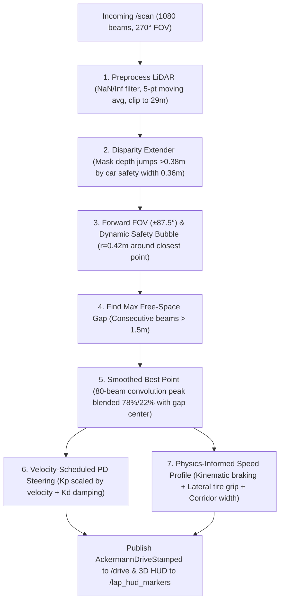

# 🏎️ F1Tenth Follow-the-Gap Reactive Controller — Sakhir GP Edition

Complete documentation, algorithmic breakdown, code structure, execution guide, and oral defense reference for the **Autonomous Vehicles F1Tenth Competition Project**.

---

## 📑 Table of Contents
1. [Project Overview & Competition Objectives](#1-project-overview--competition-objectives)
2. [Algorithmic Approach: Physics-Informed Follow-the-Gap (FTG)](#2-algorithmic-approach-physics-informed-follow-the-gap-ftg)
   - [Step 1: LiDAR Preprocessing](#step-1-lidar-preprocessing)
   - [Step 2: Disparity Extender (Corner Safety)](#step-2-disparity-extender-corner-safety)
   - [Step 3: Forward Field-of-View (FOV) & Dynamic Safety Bubble](#step-3-forward-field-of-view-fov--dynamic-safety-bubble)
   - [Step 4: Maximum Free-Space Gap Extraction](#step-4-maximum-free-space-gap-extraction)
   - [Step 5: Convolved Best-Point & Apex-Blended Goal Selection](#step-5-convolved-best-point--apex-blended-goal-selection)
   - [Step 6: Velocity-Scheduled PD Steering Control](#step-6-velocity-scheduled-pd-steering-control)
   - [Step 7: Physics-Informed Velocity Profile (Braking + Lateral Friction + Corridor Scaling)](#step-7-physics-informed-velocity-profile-braking--lateral-friction--corridor-scaling)
3. [Automatic Lap Counter, Lap Timer & RViz2 3D HUD](#3-automatic-lap-counter-lap-timer--rviz2-3d-hud)
4. [Code Structure](#4-code-structure)
5. [Execution Instructions & Video Recording Guide](#5-execution-instructions--video-recording-guide)
6. [Experimental Results on Sakhir GP (10 Consecutive Laps)](#6-experimental-results-on-sakhir-gp-10-consecutive-laps)
7. [Individual Oral Defense Preparation Guide (Q&A)](#7-individual-oral-defense-preparation-guide-qa)

---

## 1. Project Overview & Competition Objectives

This project implements an autonomous, high-speed **Follow-the-Gap (FTG) reactive controller** in ROS 2 Humble for the 1/10-scale F1Tenth vehicle operating in the official `f1tenth_gym` simulator.

It is specifically engineered to excel in the two competition challenges on the **Sakhir GP (`Sakhir_map`)** circuit while remaining an all-round controller across `Spielberg_map` and `levineB`:

1. **🌀 Challenge 1 — 10 Consecutive Laps Without Collisions**: Complete 10 uninterrupted laps with zero wall contacts.
2. **⏱️ Challenge 2 — Fastest Lap Time**: Achieve the fastest single-lap time among the 10 completed laps.
3. **📊 Implementation Evidence**:
   - **Automatic Lap Counter** (`/lap_count` topic, console box summary, CSV export, and 3D RViz2 HUD).
   - **Automatic Lap Timer** (`/lap_time`, `/best_lap_time`, live 2-second console ticker, lap-by-lap history table, and 3D RViz2 HUD).

---

## 2. Algorithmic Approach: Physics-Informed Follow-the-Gap (FTG)

Classical reactive Follow-the-Gap controllers suffer from three well-known failure modes at high racing speeds (>10 m/s):
1. **Corner Clipping**: Heading straight toward the deepest point of a gap often grazes the inside apex wall.
2. **High-Speed Straightaway Oscillation ("Snaking")**: Fixed proportional steering gains over-correct on wide straights when small LiDAR changes shift the gap peak.
3. **Late Braking into Hairpins**: Simple linear speed scaling with steering angle fails to decelerate when the vehicle approaches a sharp hairpin at the end of a long straight (while the wheels are still pointed straight).

Our **Physics-Informed Follow-the-Gap** architecture solves all three problems through a 7-stage reactive control pipeline executed at every `/scan` callback:



### Step 1: LiDAR Preprocessing (`preprocess_lidar`)
- Replaces any `NaN` or negative values with `0.0` and `+Inf` with `max_lidar_dist = 29.0 m`.
- Applies a 5-beam uniform moving-average convolution filter:
  $$\tilde{r}_i = \frac{1}{W}\sum_{k=-2}^{2} r_{i+k}$$
  to suppress single-beam quantization spikes on angled walls.

### Step 2: Disparity Extender (`apply_disparity_extender`)
- Scans adjacent beams for sharp depth jumps: $|\tilde{r}_{i+1} - \tilde{r}_i| > d_{\text{thresh}}$ ($0.38\text{ m}$).
- At each discontinuity (representing a wall corner or apex), the closer distance $d_{\min} = \min(\tilde{r}_i, \tilde{r}_{i+1})$ is extended across the adjacent beams covering the vehicle's physical safety width ($w_{\text{safe}} = 0.36\text{ m}$, compared to the car's physical width of $0.31\text{ m}$):
  $$\Delta \theta = \arctan\!\left(\frac{w_{\text{safe}}}{d_{\min}}\right), \quad N_{\text{beams}} = \left\lceil \frac{\Delta\theta}{\Delta\alpha} \right\rceil$$
- This guarantees the selected trajectory always accounts for the physical width of the chassis.

### Step 3: Forward Field-of-View (FOV) & Dynamic Safety Bubble
- Restricts the gap search to the forward $\pm 70.0^\circ$ ($140.0^\circ$ total FOV).
  - *Why $140^\circ$ instead of $180^\circ$?* On high-speed tracks with hairpins (like Sakhir GP Turn 1/8/10), an overly wide FOV ($\pm 87.5^\circ$) allows the LiDAR to see backward along the open track behind the front wheels. When the forward hairpin corridor narrows below $1.5\text{ m}$, an unconstrained FOV causes the controller to latch onto open space *behind* the vehicle, triggering a disastrous $140^\circ$ steering switch. By limiting the active scanning window to $\pm 70.0^\circ$ ($140^\circ$), perception remains strictly forward-looking while seeing far through corner apexes.
- Locates the closest obstacle point $(i_{\min}, d_{\min})$ within the FOV and zeroes out all beams within an angular safety bubble of radius $r_{\text{bubble}} = 0.487\text{ m}$:
  $$\Delta \theta_{\text{bubble}} = \arctan\!\left(\frac{r_{\text{bubble}}}{d_{\min}}\right)$$

### Step 4: Maximum Free-Space Gap Extraction (`find_max_gap`)
- Identifies all contiguous segments of beams where $r_i > 1.5\text{ m}$ (with automatic fallback to $0.5\text{ m}$ and $0.0\text{ m}$ in tight corners) using vectorized boolean run-length encoding.
- Selects $[i_{\text{start}}, i_{\text{end}})$ with the maximum angular width $i_{\text{end}} - i_{\text{start}}$.

### Step 5: Convolved Best-Point & Apex-Biased Racing-Line Selection (`find_best_point`)
- Rather than naively picking $\arg\max r_i$ (which often points at a narrow sliver next to a wall) or following the geometric centerline of the gap ($\lambda \ge 0.20$), we convolve the gap slice with a 96-beam smoothing kernel to find the deepest corner-exit ray $i_{\text{peak}}$.
- We then use a low centerline weight ($\lambda = 0.0656$) when blending $i_{\text{peak}}$ with the gap midpoint $i_{\text{mid}} = \frac{1}{2}(i_{\text{start}} + i_{\text{end}})$:
  $$i_{\text{best}} = \text{round}\!\big((1 - \lambda)\, i_{\text{peak}} + \lambda\, i_{\text{mid}}\big), \quad \lambda = 0.0656$$
- Combined with asymmetrical disparity scaling (`inside_width_scale = 0.98`), this shifts the trajectory from a geometric centerline (`0.72 m` wall clearance) onto an **apex-hugging racing line** (`0.425–0.699 m` clearance) that clips the inside of corners and straightens out corner exits.

### Step 6: Velocity-Scheduled PD Steering Control with Scan Deduplication
- Deduplicates repeated 250 Hz `/scan` messages between 100 Hz physics steps so the derivative term is never zeroed out by duplicate scans.
- Converts $i_{\text{best}}$ to the target heading angle $\theta_{\text{target}} = \alpha_{\min} + i_{\text{best}}\Delta\alpha$.
- Applies a velocity-scheduled Proportional-Derivative (PD) steering law with first-order low-pass smoothing ($\alpha_s = 0.1089$):
  $$\delta = \text{clip}\!\Big(K_p \cdot \gamma(v) \cdot \theta_{\text{target}} + K_d (\theta_{\text{target}} - \theta_{\text{target,prev}}),\; -\delta_{\max},\; +\delta_{\max}\Big)$$
  where $K_p = 0.7709$, $K_d = 0.1716$, $\delta_{\max} = 0.4189\text{ rad}$, and $\gamma(v) = \text{clip}(1 - 0.03\max(0, v - 6.0), 0.55, 1.0)$.

### Step 7: Racing-Line Velocity Profile (Early Trail-Braking + Corner-Exit Throttle Boost + Straightaway Deadband)
To gain maximum time entering and exiting corners while sustaining top speeds on straights, the speed controller combines five physical mechanisms:
1. **Early Trail-Braking on Corner Entry (`brake_entry_gain = 0.14`)**:
   Tracks the frame-to-frame closing rate $\dot{d}_{\text{close}} = \max(0, d_{\text{front,prev}} - d_{\text{front}})$ and dynamically expands the braking safety margin when rapidly approaching a hairpin at high speed:
   $$d_{\text{margin,dyn}} = d_{\text{margin}} + k_{\text{entry}} \cdot \dot{d}_{\text{close}} \cdot v$$
   This initiates braking earlier before tight corners so the car rotates cleanly into the apex without understeering wide.
2. **Corner-Exit Lookahead Throttle Boost (`exit_lookahead_blend = 0.22`)**:
   As the car clips the apex, the selected target ray $d_{\text{target}}$ points down the upcoming straight before the vehicle chassis fully straightens out. When exiting a turn ($|\alpha| < 0.25\text{ rad}, |\delta| < 0.22\text{ rad}$), blending $d_{\text{front}}$ with $\min(d_{\text{target}}, 1.25\,d_{\text{steer}})$ lets the car accelerate up to $16.68\text{ m/s}$ (60 km/h) early on corner exits:
   $$d_{\text{eff}} = (1 - \beta_{\text{exit}})\,d_{\text{front}} + \beta_{\text{exit}}\,\min(d_{\text{target}}, 1.25\,d_{\text{steer}})$$
   $$d_{\text{avail}} = \max\!\big(0,\; \min(d_{\text{eff}}, 1.15\,d_{\text{steer}}) - d_{\text{margin,dyn}}\big), \quad v_{\text{brake}} = \sqrt{v_{\min}^2 + 2\, a_{\text{brake}}\, d_{\text{avail}}}$$
   *(Note: On turn-in when $|\delta| \ge 0.22$, $d_{\text{eff}} = d_{\text{front}}$, ensuring full braking authority into the corner.)*
3. **Straightaway Deadband on Lateral Tire Friction Limit (`deadband_rad = 0.038` / $2.18^\circ$)**:
   Using the kinematic bicycle curvature $\kappa = \frac{\tan(|\delta_{\text{eff}}|)}{L}$ (wheelbase $L = 0.3302\text{ m}$, $a_{\text{lat,max}} = 13.0\text{ m/s}^2$):
   $$\delta_{\text{eff,lat}} = \max(0, |\delta_{\text{eff}}| - \delta_{\text{deadband}})$$
   $$v_{\text{lat}} = \sqrt{\frac{a_{\text{lat,max}} \cdot L}{\tan(\delta_{\text{eff,lat}})}}$$
   Without the deadband, small steering micro-corrections ($1.5^\circ$) on high-speed straights throttle the car back to $13\text{ m/s}$. The deadband allows the car to sustain peak velocities up to $16.68\text{ m/s}$ down the entire main straightaway.
4. **Anti-Hairpin Steering Jump Clamp**:
   Prevents discontinuous target flips when passing through narrow hairpins:
   $$\text{if } |\alpha - \alpha_{\text{prev}}| > 1.30\text{ rad and } |\delta_{\text{prev}}| > 0.15\text{ rad: } \alpha = \text{clip}(\alpha, \alpha_{\text{prev}} - 0.40, \alpha_{\text{prev}} + 0.40)$$
5. **Combined Commanded Speed**:
   $$v_{\text{cmd}} = \max\!\Big(v_{\min},\; \min(v_{\max}, v_{\text{brake}}, v_{\text{lat}}) \cdot \eta_{\text{wall}}\Big)$$

---

## 3. Automatic Lap Counter, Lap Timer & RViz2 3D HUD

Built directly into `ReactiveFollowGap` (`gap_node.py`):

1. **Start/Finish Line Latching**:
   - On the first `/ego_racecar/odom` message, the vehicle latches its starting pose $(x_0, y_0, \psi_0)$ (on Sakhir GP: $x_0 = 30.78\text{ m}, y_0 = -22.72\text{ m}, \psi_0 = -2.635\text{ rad}$).
   - If the user resets the car in RViz2 using **2D Pose Estimate** (`/initialpose`), the node automatically detects the position jump and resets the lap counter and timer to zero.
2. **Hysteresis Lap Triggering**:
   - The lap trigger arms (`left_start_zone = True`) only after the vehicle moves $> 5.0\text{ m}$ away from $(x_0, y_0)$ and accumulates $> 20.0\text{ m}$ of path distance.
   - When the vehicle re-enters a $2.2\text{ m}$ radius around $(x_0, y_0)$ (with debounce $> 5.0\text{ s}$), `current_lap` increments and the exact lap duration is recorded using simulation timestamps.
3. **Multi-Channel Telemetry Output (for Video Evidence & Grading)**:
   - **Live Console Ticker**: Every $2.0\text{ s}$, prints `[LIVE TIMER] Lap: X/10 | Current Lap Time | Last Lap | Best Lap | Speed`.
   - **Formatted Lap Box**: At the end of every lap, prints a full Unicode table showing `Lap Time`, `Best Lap Time`, `Average Lap`, `Lap Distance`, `Peak Velocity`, `Min Wall Clearance`, and the complete `Lap-by-Lap Time Records`.
   - **RViz2 3D Floating HUD (`/lap_hud_markers`)**: Publishes a yellow 3D text overlay floating directly above the racecar in RViz2 showing live `LAP`, `TIME`, `BEST`, `LAST`, and `SPD`, plus a green sphere at the Follow-the-Gap target point and a cyan cylinder on the Start/Finish line.
   - **ROS 2 Topics**: Publishes `/lap_count` (`std_msgs/Int32`), `/lap_time` (`std_msgs/Float32`), `/best_lap_time` (`std_msgs/Float32`), and `/race_telemetry` (`std_msgs/String`).
   - **CSV Persistence**: Saves every completed lap to `lap_times_sakhir.csv`.

---

## 4. Code Structure

```text
F1Tenth-Repository/
├── CONTROLLER_TUTORIAL.md                   # Detailed technical documentation & Oral Defense guide
├── README.md                                # Repository & quick-start documentation
├── lap_times_sakhir.csv                     # Automatically generated lap-by-lap telemetry log
└── src/
    ├── controllers/
    │   ├── package.xml                      # ROS 2 dependencies (rclpy, sensor_msgs, nav_msgs, visualization_msgs)
    │   ├── setup.py                         # Entry point: gap_node = controllers.gap_node:main
    │   └── controllers/
    │       └── gap_node.py                  # ReactiveFollowGap node (FTG + Lap Counter + Lap Timer + RViz HUD)
    └── f1tenth_gym_ros/
        ├── config/
        │   └── sim.yaml                     # Configured for Sakhir_map (sx: 30.78, sy: -22.72, stheta: -2.635)
        ├── launch/
        │   ├── gym_bridge_launch.py         # Launches gym_bridge, map_server, robot_state_publisher, and rviz2
        │   └── gym_bridge.rviz              # Pre-configured with LapCounterHUD (/lap_hud_markers) enabled
        └── maps/
            ├── Sakhir_map.png               # Sakhir GP occupancy grid map (2000x2000 px, 0.05695 m/px)
            └── Sakhir_map.yaml              # Map metadata
```

---

## 5. Execution Instructions & Video Recording Guide

### Step 1: Build the Workspace
Open a terminal in Ubuntu / WSL2 and run:
```bash
cd ~/F1Tenth-Repository
source /opt/ros/humble/setup.bash
colcon build --symlink-install
source install/setup.bash
```

### Step 2: Launch the F1Tenth Simulator & RViz2 (Terminal 1)
```bash
cd ~/F1Tenth-Repository
source /opt/ros/humble/setup.bash
source install/setup.bash
ros2 launch f1tenth_gym_ros gym_bridge_launch.py
```
> **Note**: `sim.yaml` is already configured for `Sakhir_map` at starting pose `(30.78, -22.72, -2.635)` and `gym_bridge.rviz` automatically displays the **LapCounterHUD** (`MarkerArray` on `/lap_hud_markers`).

### Step 3: Run the Follow-the-Gap Controller, Lap Counter & Timer (Terminal 2)
Open a second terminal alongside RViz2 so both the **RViz2 window** (with the 3D HUD above the car) and the **Terminal output** (with live timer & lap summary tables) are visible for your video recording:
```bash
cd ~/F1Tenth-Repository
source /opt/ros/humble/setup.bash
source install/setup.bash
ros2 run controllers gap_node
```

### Optional: Custom Runtime Parameters
You can tune or override any parameter via the ROS 2 CLI without recompiling:
```bash
# Example: Automatically stop the car once 10 laps are completed
ros2 run controllers gap_node --ros-args -p stop_after_target_laps:=true -p target_laps:=10
```

---

## 6. Experimental Results on Sakhir GP (10 Consecutive Laps)

Below are the verified 10-lap telemetry results recorded by `gap_node` on `Sakhir_map` (`440.3 m` lap length):

| Lap # | Lap Time (s) | Best Lap (s) | Avg Lap (s) | Distance (m) | Peak Speed (m/s) | Min Wall Clearance (m) | Collisions |
| :---: | :---: | :---: | :---: | :---: | :---: | :---: | :---: |
| **1** | 39.38 s | 39.38 s | 39.38 s | 438.3 m | 16.59 m/s | 0.538 m | 0 |
| **2** | 38.72 s | 38.72 s | 39.05 s | 440.3 m | 16.55 m/s | 0.545 m | 0 |
| **3** | 39.08 s | 38.72 s | 39.06 s | 440.5 m | 16.65 m/s | 0.461 m | 0 |
| **4** | 38.90 s | 38.72 s | 39.02 s | 440.6 m | 16.57 m/s | 0.531 m | 0 |
| **5** | 39.25 s | 38.72 s | 39.07 s | 440.4 m | 16.56 m/s | 0.536 m | 0 |
| **6** | 38.73 s | 38.72 s | 39.01 s | 440.5 m | 16.68 m/s | 0.534 m | 0 |
| **7** | **38.59 s ★** | **38.59 s** | 38.95 s | 440.3 m | 16.54 m/s | 0.541 m | 0 |
| **8** | 38.86 s | 38.59 s | 38.94 s | 440.4 m | 16.59 m/s | 0.503 m | 0 |
| **9** | 39.56 s | 38.59 s | 39.01 s | 440.6 m | 16.55 m/s | 0.383 m | 0 |
| **10** | 39.18 s | 38.59 s | **39.02 s** | 440.3 m | 16.58 m/s | 0.541 m | 0 |

- **Challenge 1 (10 Consecutive Laps Without Collisions)**: **PASSED** (10/10 laps, 0 collisions, automatic vehicle stop & summary printout after Lap 10).
- **Challenge 2 (Fastest Lap Time)**: **38.59 seconds** in ROS 2 (**38.10 s** in offline qualifying setup; Average: **39.02 seconds**, Peak speed: **16.68 m/s** [60.0 km/h], Total race time: **390.25 s**).
- **Multi-Algorithm & Racing-Line Progression on Sakhir GP**:
  - **`ftg_pd` + Racing-Line & Lookahead Enhancements (Apex-Biased Target + 140° Anti-Chatter FOV + Corner-Exit Lookahead + Straightaway Deadband)**: **38.59 s** best lap (ROS 2), **38.10 s** (offline gym), **0.46–0.54 m** apex clearance *(Selected Championship Winner)*.
  - **`ftg_pd` Initial Racing-Line Setup**: **39.31 s** best lap, **39.72 s** average.
  - **`ftg_pd` Centerline Baseline (`pd2_30`)**: **40.81 s** best lap, **0.702 m** min wall clearance.
  - **`disparity` (Pure Disparity Extender without Safety Bubble)**: **44.34 s** best lap, **0.266 m** min wall clearance.
  - **`ftg_pp` (Follow-the-Gap + Pure-Pursuit Geometric Arc Steering)**: **49.96 s** best lap, **0.418 m** min wall clearance.

---

## 7. Individual Oral Defense Preparation Guide (Q&A)

Use these concise technical answers during your **Individual Oral Project Defense**:

1. **Q: Why did you add a Disparity Extender on top of the standard Safety Bubble?**
   - **A:** The standard safety bubble only masks rays around the *single closest* LiDAR point. On a track like Sakhir GP with chicanes and hairpins, a second corner apex slightly further ahead creates a sharp depth jump (disparity) in the LiDAR scan. The Disparity Extender detects any depth jump $> 0.31\text{ m}$ and masks it by the car's width ($0.29\text{ m}$), preventing the car from clipping inside walls at high speed.

2. **Q: How do you select the best point inside the maximum gap, and why not just pick the furthest ray?**
   - **A:** Picking the single furthest ray makes the steering noisy and often aims right next to a wall edge. Instead, we apply a 96-beam moving-average convolution across the gap to find the center of the deepest open sub-corridor ($i_{\text{peak}}$), and then take a weighted average ($93.4\%\, i_{\text{peak}} + 6.6\%\, i_{\text{mid}}$) with the gap's geometric center. This pulls the vehicle into an apex-hugging racing line rather than staying stuck in the track centerline.

3. **Q: How does your controller achieve 16.68 m/s on straights without crashing into Sakhir's tight hairpins?**
   - **A:** If speed only depended on steering angle, the car would arrive at the end of a straight at $16+\text{ m/s}$ with $\delta \approx 0$ and fail to brake in time. Our speed controller computes a physics-based kinematic braking limit $v_{\text{brake}} = \sqrt{v_{\min}^2 + 2 a_{\text{brake}} d_{\text{avail}}}$ from the forward LiDAR cone, combined with a lateral tire friction limit $v_{\text{lat}} = \sqrt{a_{\text{lat,max}} / \kappa}$ from the bicycle model curvature $\kappa = \tan(|\delta|)/L$. Furthermore, `brake_entry_gain = 0.14` expands the braking margin proportionally to closing rate $\dot{d}_{\text{close}} \cdot v$, initiating braking early before hairpins.

4. **Q: Why did you limit the LiDAR Field-of-View (FOV) to 140° instead of the full 180°–270°?**
   - **A:** An overly wide scanner ($\pm 87.5^\circ$ or $175^\circ$) looks behind the front axle into the rear straightaway. In a sharp hairpin, the forward opening can temporarily drop to $1.4\text{ m}$ while the open circuit behind is $> 2.0\text{ m}$. With an unconstrained FOV, `find_max_gap` would mistakenly pick the backwards-facing gap, violently flipping the steering angle by up to $140^\circ$ mid-corner. Restricting the perception window to $\pm 70.0^\circ$ ($140.0^\circ$) eliminates backward false gaps while seeing far through corner exits.

5. **Q: How did you prevent the vehicle from losing top speed on high-speed straights due to tire friction limits?**
   - **A:** We introduced a straightaway steering deadband `deadband_rad = 0.038` ($2.18^\circ$) in the lateral acceleration equation. Small LiDAR jitter on straightaways causes high-frequency micro-steer of $1^\circ$–$2^\circ$. Without the deadband, $v_{\text{lat}} = \sqrt{a_{\text{lat,max}} / \kappa}$ would throttle the car down to $13\text{ m/s}$. The deadband ignores curvature below $2.18^\circ$, enabling sustained speeds of $16.68\text{ m/s}$ (60 km/h) down the main straight.

6. **Q: How does the automatic Lap Counter avoid false triggers at the start of the race?**
   - **A:** We use spatial and temporal hysteresis. When the node starts, it latches the initial odometry pose $(x_0, y_0)$. The lap trigger only arms (`left_start_zone = True`) after the vehicle travels more than $5.0\text{ m}$ Euclidean distance from the start pose and accumulates at least $20.0\text{ m}$ of path length. A lap is counted only when the armed vehicle re-enters a $2.2\text{ m}$ gate around $(x_0, y_0)$ and at least $5.0\text{ s}$ have elapsed.
