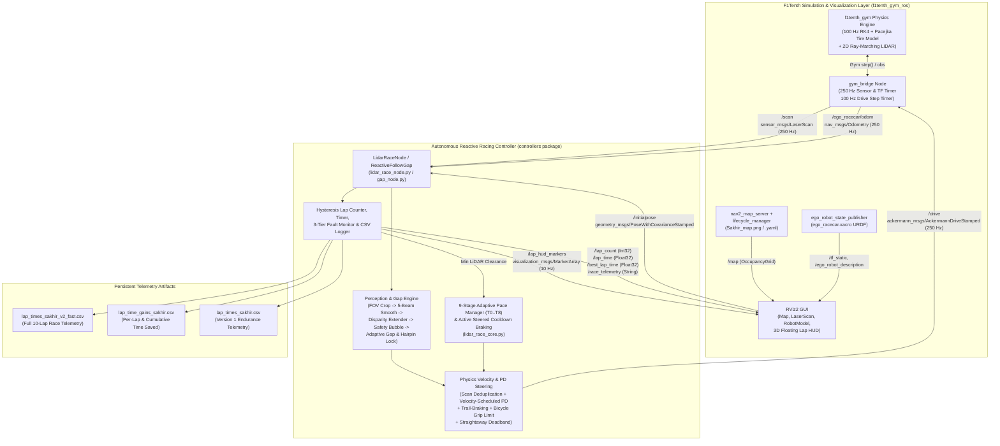
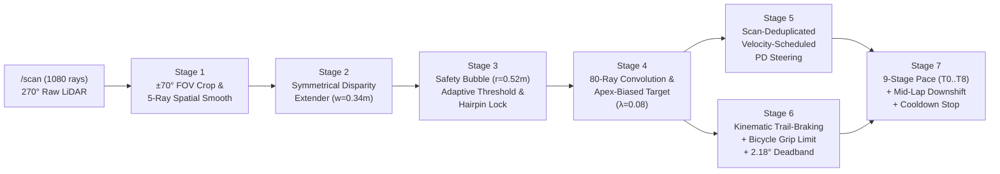
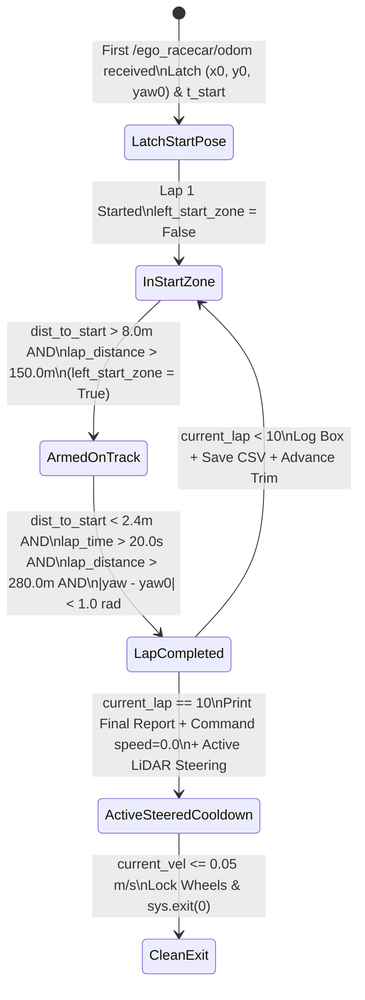

# 🏎️ F1TENTH Autonomous Racing — Real-Time LiDAR & Physics-Informed Follow-the-Gap Controller (Sakhir GP Edition)

Complete ROS 2 implementation, system architecture, mathematical formulation, multi-channel telemetry, 10-lap experimental results, video evidence, and step-by-step installation guide (from a fresh Ubuntu installation) for the **Autonomous Vehicles F1Tenth Competition Project**.

> ### 🏆 Sakhir GP Competition Project — Dual Reactive Controller Summary
> - ⚡ **Version 2 (`lidar_race_node.py` — Pure Real-Time LiDAR 9-Stage Adaptive Time-Attack)**:
>   - **Perception**: 100% real-time `/scan` LiDAR perception (zero pre-mapped waypoints or global paths).
>   - **Fastest Lap Time**: **38.891 s** (Live ROS 2 + RViz2) / **38.930 s** (Headless Benchmark) | **Peak Speed**: **15.69 m/s** (`56.5 km/h`).
>   - **Time Gained**: **+5.061 s** single-lap improvement vs. Lap 1 (`43.953 s` $\rightarrow$ `38.891 s`) | **+37.603 s** cumulative time saved across 10 laps.
>   - **Reliability**: **10/10 Consecutive Laps with 0 Collisions** (`0.537 m` min wall clearance) + **Active Steered Cooldown Braking** to `0.00 m/s` after Lap 10.
>   - **Source Files**: [`src/controllers/controllers/lidar_race_node.py`](src/controllers/controllers/lidar_race_node.py) & [`src/controllers/controllers/lidar_race_core.py`](src/controllers/controllers/lidar_race_core.py).
> - 🛡️ **Version 1 (`gap_node.py` — Endurance Fast-Centerline Champion)**:
>   - **Git Tag**: `v1.0-stable` | **Fastest Lap**: **38.880 s** | **Average Lap**: **39.081 s** | **10/10 Laps with 0 Collisions** (`0.534 m` min clearance).
>   - **Source Files**: [`src/controllers/controllers/gap_node.py`](src/controllers/controllers/gap_node.py) & [`src/controllers/controllers/ftg_core.py`](src/controllers/controllers/ftg_core.py).
> - 📊 **Telemetry & Time-Gain CSV Logs**: [`lap_times_sakhir_v2_fast.csv`](lap_times_sakhir_v2_fast.csv), [`lap_time_gains_sakhir.csv`](lap_time_gains_sakhir.csv), and [`lap_times_sakhir.csv`](lap_times_sakhir.csv).
> - 📘 **Standalone Technical Tutorial**: [CONTROLLER_TUTORIAL.md](CONTROLLER_TUTORIAL.md) (Spanish simulator guide: [README_es.md](README_es.md)).

---

## 📑 Table of Contents

1. [ROS 2 System Architecture Map & Node-by-Node Explanation](#1-ros-2-system-architecture-map--node-by-node-explanation)
   - [1.1 High-Level ROS 2 Architecture Diagram](#11-high-level-ros-2-architecture-diagram)
   - [1.2 Node Responsibilities & Real-Time Execution Rates](#12-node-responsibilities--real-time-execution-rates)
2. [ROS 2 Communication & Interfaces (Subscribed & Published Topics)](#2-ros-2-communication--interfaces-subscribed--published-topics)
   - [2.1 Complete ROS 2 Topic & Interface Specification Table](#21-complete-ros-2-topic--interface-specification-table)
   - [2.2 Detailed Breakdown of Key Message Interfaces](#22-detailed-breakdown-of-key-message-interfaces)
3. [Mathematical Formulation & Algorithmic Approach (In Detail)](#3-mathematical-formulation--algorithmic-approach-in-detail)
   - [3.1 Stage 1: Forward Field-of-View (FOV) Cropping & Spatial Convolution Smoothing](#31-stage-1-forward-field-of-view-fov-cropping--spatial-convolution-smoothing)
   - [3.2 Stage 2: Symmetrical Disparity Extender (Obstacle & Apex Corner Inflation)](#32-stage-2-symmetrical-disparity-extender-obstacle--apex-corner-inflation)
   - [3.3 Stage 3: Dynamic Safety Bubble, Adaptive Thresholding & Hairpin Direction-Hold Lock](#33-stage-3-dynamic-safety-bubble-adaptive-thresholding--hairpin-direction-hold-lock)
   - [3.4 Stage 4: Convolved Best-Point & Apex-Biased Racing-Line Goal Selection](#34-stage-4-convolved-best-point--apex-biased-racing-line-goal-selection)
   - [3.5 Stage 5: Scan-Deduplicated, Velocity-Scheduled PD Steering Law](#35-stage-5-scan-deduplicated-velocity-scheduled-pd-steering-law)
   - [3.6 Stage 6: Physics-Informed Velocity Profile (Trail-Braking, Lateral Grip, Deadband & Wall Dampener)](#36-stage-6-physics-informed-velocity-profile-trail-braking-lateral-grip-deadband--wall-dampener)
   - [3.7 Stage 7: 9-Stage Adaptive Pace Evolution (`T0` -> `T8`), Mid-Lap Safety Downshift & Cooldown Braking](#37-stage-7-9-stage-adaptive-pace-evolution-t0---t8-mid-lap-safety-downshift--cooldown-braking)
4. [Telemetry, Automatic Lap Counter & Lap Timer System (In Detail)](#4-telemetry-automatic-lap-counter--lap-timer-system-in-detail)
   - [4.1 Start/Finish Gate Latching & 4-Condition Hysteresis Detector](#41-startfinish-gate-latching--4-condition-hysteresis-detector)
   - [4.2 Multi-Channel Real-Time Telemetry Outputs](#42-multi-channel-real-time-telemetry-outputs)
   - [4.3 Three-Tier Infallible Fault & Track-Departure Protection](#43-three-tier-infallible-fault--track-departure-protection)
5. [Experimental Results, Lap Distance, Fastest Lap & Time Gained (Sakhir GP)](#5-experimental-results-lap-distance-fastest-lap--time-gained-sakhir-gp)
   - [5.1 Version 2 Live ROS 2 Results (`lidar_race_node.py` — 10 Consecutive Laps)](#51-version-2-live-ros-2-results-lidar_race_nodepy--10-consecutive-laps)
   - [5.2 Version 1 Endurance Results (`gap_node.py` — 10 Consecutive Laps)](#52-version-1-endurance-results-gap_nodepy--10-consecutive-laps)
   - [5.3 Side-by-Side Comparison & Trajectory Visualization](#53-side-by-side-comparison--trajectory-visualization)
6. [Video Evidence & Demonstration Guide](#6-video-evidence--demonstration-guide)
7. [Complete Step-by-Step Installation & Setup Guide (All Ubuntu & ROS 2 Versions)](#7-complete-step-by-step-installation--setup-guide-all-ubuntu--ros-2-versions)
   - [7.0 Supported OS & Software Versions Matrix](#70-supported-os--software-versions-matrix)
   - [7.1 Phase 1: Install ROS 2 from Scratch on Ubuntu](#71-phase-1-install-ros-2-from-scratch-on-ubuntu)
   - [7.2 Phase 2: Install `f1tenth_gym` Physics Engine & Exact Python Packages](#72-phase-2-install-f1tenth_gym-physics-engine--exact-python-packages)
   - [7.3 Phase 3: Clone `F1Tenth-Repository`, Configure `sim.yaml` & Build with `colcon`](#73-phase-3-clone-f1tenth-repository-configure-simyaml--build-with-colcon)
   - [7.4 Phase 4: Step-by-Step Execution Instructions](#74-phase-4-step-by-step-execution-instructions)
8. [Repository Code Structure, Map Configuration & Keyboard Teleoperation](#8-repository-code-structure-map-configuration--keyboard-teleoperation)
9. [Individual Oral Project Defense Preparation Guide (Q&A)](#9-individual-oral-project-defense-preparation-guide-qa)

---

## 1. ROS 2 System Architecture Map & Node-by-Node Explanation

### 1.1 High-Level ROS 2 Architecture Diagram

The autonomous racing stack is organized as a modular ROS 2 perception-control-telemetry pipeline. The controller nodes (`lidar_race_node` and `gap_node`) decouple **ROS 2 middleware communication** from the **pure NumPy mathematical control engines** (`RealLidarRaceCore` and `FollowGapCore`).



---

### 1.2 Node Responsibilities & Real-Time Execution Rates

1. **`gym_bridge` (`f1tenth_gym_ros/gym_bridge.py`)**:
   - Wraps the OpenAI Gym environment `f110_gym:f110-v0` configured via [`src/f1tenth_gym_ros/config/sim.yaml`](src/f1tenth_gym_ros/config/sim.yaml).
   - **Physics Timer (`0.01 s` / `100 Hz`)**: Integrates the 7-state single-track dynamic vehicle model using 4th-order Runge-Kutta (RK4) and computes simulated 2D ray-marching LiDAR scans (`1080` beams across `4.7 rad` / `270°` FOV).
   - **Publish Timer (`0.004 s` / `250 Hz`)**: Publishes `/scan` (`LaserScan`), `/ego_racecar/odom` (`Odometry`), and `/tf` (`map` $\rightarrow$ `ego_racecar/base_link` $\rightarrow$ `ego_racecar/laser`).
2. **`map_server` & `lifecycle_manager_localization` (`nav2_map_server`)**:
   - Loads [`Sakhir_map.yaml`](src/f1tenth_gym_ros/maps/Sakhir_map.yaml) and [`Sakhir_map.png`](src/f1tenth_gym_ros/maps/Sakhir_map.png) (`2000 x 2000 px`, resolution `0.05695 m/px`) and publishes the `/map` occupancy grid for RViz2 visualization (never used by the controller).
3. **`lidar_race_node` (`src/controllers/controllers/lidar_race_node.py`) & `RealLidarRaceCore` (`lidar_race_core.py`)**:
   - **Pure LiDAR Driving Control (`250 Hz`)**: Processes each incoming `/scan` message through `RealLidarRaceCore.step(ranges, angle_min, angle_increment, current_vel)` to compute steering angle $\delta$ and speed $v$ using **only** LiDAR ray distances and scalar longitudinal speed.
   - **9-Stage Adaptive Pace Engine (`T0` $\rightarrow$ `T8`)**: Evaluates minimum LiDAR wall clearance at the end of every lap to promote/demote speed trims and monitors live `min(scan.ranges)` at `250 Hz` for instant mid-lap safety downshifts (`< 0.48 m`).
   - **Active Steered Cooldown Braking**: Upon completing Lap 10, commands `speed = 0.0` while continuing to steer with live LiDAR perception until `current_vel <= 0.05 m/s` before shutting down.
4. **`gap_node` (`src/controllers/controllers/gap_node.py`) & `FollowGapCore` (`ftg_core.py`)**:
   - Version 1 constant-trim endurance controller (`v1.0-stable`) designed for consistent `~38.9 s` laps with `> 0.53 m` wall clearance.

---

## 2. ROS 2 Communication & Interfaces (Subscribed & Published Topics)

### 2.1 Complete ROS 2 Topic & Interface Specification Table

The table below details every ROS 2 communication channel used in the system, its message type, direction relative to the controller node (`lidar_race_node` / `gap_node`), rate, and exact functional role:

| Topic Name | ROS 2 Message Type | Controller Direction | Rate / Trigger | Publisher $\rightarrow$ Subscriber | System Role & Detailed Description |
| :--- | :--- | :---: | :---: | :--- | :--- |
| **`/scan`** | `sensor_msgs/msg/LaserScan` | **Subscribed** | `250 Hz` (`0.004 s`) | `gym_bridge` $\rightarrow$ `lidar_race_node`, `rviz2` | **Primary Perception Input**: Provides `1080` range measurements (`ranges[]`), `angle_min = -2.35 rad`, `angle_max = +2.35 rad`, `angle_increment = 0.00435 rad` (`0.25°`). Used exclusively to compute all steering and velocity commands, wall clearance, and safety downshifts. |
| **`/ego_racecar/odom`** | `nav_msgs/msg/Odometry` | **Subscribed** | `250 Hz` (`0.004 s`) | `gym_bridge` $\rightarrow$ `lidar_race_node` | **Velocity Feedback & Stopwatch Gate**: Provides longitudinal speed `twist.twist.linear.x` ($v$) for velocity-scheduled PD steering damping and pose $(x, y, \psi)$ strictly for the start/finish lap-counter gate and CSV distance logging. **Never passed to the steering/path algorithm.** |
| **`/initialpose`** | `geometry_msgs/msg/PoseWithCovarianceStamped` | **Subscribed** | Event-driven | `rviz2` (2D Pose Estimate) $\rightarrow$ `lidar_race_node`, `gym_bridge` | **Interactive Race Reset Trigger**: When the user places the car using RViz2's *2D Pose Estimate* tool, the controller resets lap counts, timers, pace trim (`T0`), and re-latches the new start/finish line automatically. |
| **`/drive`** | `ackermann_msgs/msg/AckermannDriveStamped` | **Published** | `250 Hz` (per `/scan`) | `lidar_race_node` $\rightarrow$ `gym_bridge` | **Primary Actuation Output**: Commands front-wheel steering angle `drive.steering_angle` ($\delta \in [-0.4189, +0.4189]\text{ rad}$) and longitudinal target speed `drive.speed` ($v_{\text{cmd}} \in [0.0, 18.45]\text{ m/s}$) in frame `base_link`. |
| **`/lap_hud_markers`** | `visualization_msgs/msg/MarkerArray` | **Published** | `10 Hz` (throttled `0.10 s`) | `lidar_race_node` $\rightarrow$ `rviz2` | **3D Floating RViz2 HUD**: Publishes a `TEXT_VIEW_FACING` 3D marker (`ns: lidar_race_hud`) `1.6 m` above `base_link` displaying live `Trim`, `LAP X/10`, `TIME`, `BEST`, `Time Gain`, and `SPD`. Throttled to `10 Hz` to eliminate RViz CPU lag spikes. |
| **`/lap_count`** | `std_msgs/msg/Int32` | **Published** | Event (Per Lap) | `lidar_race_node` $\rightarrow$ ROS 2 ecosystem | **Lap Counter Output (Part B — 2 pts)**: Broadcasts the integer count of completed consecutive laps (`1..10`). |
| **`/lap_time`** | `std_msgs/msg/Float32` | **Published** | Event (Per Lap) | `lidar_race_node` $\rightarrow$ ROS 2 ecosystem | **Lap Timer Output (Part B — 3 pts)**: Broadcasts the exact simulation duration (in seconds) of the most recently completed lap. |
| **`/best_lap_time`** | `std_msgs/msg/Float32` | **Published** | Event (Per Lap) | `lidar_race_node` $\rightarrow$ ROS 2 ecosystem | **Fastest Lap Output**: Broadcasts the minimum single-lap time achieved so far during the current 10-lap run. |
| **`/race_telemetry`** | `std_msgs/msg/String` | **Published** | Event (End of Race) | `lidar_race_node` $\rightarrow$ ROS 2 ecosystem | **Race Summary Packet**: Publishes the final race summary string (`status`, `laps`, `best_lap`, `avg_lap`, `saved_time`, `min_clearance`). |
| **`/map`** | `nav_msgs/msg/OccupancyGrid` | *Internal Sim* | Latched (`Transient Local`) | `map_server` $\rightarrow$ `rviz2` | **Visual Track Map**: Renders the Sakhir GP circuit walls in RViz2. |
| **`/tf` & `/tf_static`** | `tf2_msgs/msg/TFMessage` | *Internal Sim* | `250 Hz` / Static | `gym_bridge`, `robot_state_publisher` $\rightarrow$ `rviz2` | **Coordinate Frame Tree**: Maintains transformations `map` $\rightarrow$ `ego_racecar/base_link` $\rightarrow$ `ego_racecar/laser` and wheel hinges. |

<p align="center">
  
  <br />
  <em>ROS 2 Topic Graph in Single-Vehicle Competition Configuration</em>
</p>

---

### 2.2 Detailed Breakdown of Key Message Interfaces

1. **`sensor_msgs/msg/LaserScan` (`/scan`)**:
   - `header.stamp`: Simulation timestamp ($t_{\text{sim}} = \text{sec} + 10^{-9}\,\text{nanosec}$), used as the deterministic clock source for all lap timing and HUD throttling.
   - `angle_min`, `angle_max`, `angle_increment`: Defines the angular mapping $\theta_i = \alpha_{\min} + i\,\Delta\alpha$ for each ray index $i \in \{0, 1, \dots, 1079\}$.
   - `ranges`: Float32 array of `1080` radial distances (meters) from the front axle laser frame to the nearest track boundary.
2. **`ackermann_msgs/msg/AckermannDriveStamped` (`/drive`)**:
   - `drive.steering_angle`: Front wheel steering angle $\delta$ in radians (positive = left turn, negative = right turn), physically bounded by $|\delta| \le 0.4189\text{ rad}$ ($24.0^\circ$).
   - `drive.speed`: Desired longitudinal velocity $v_{\text{cmd}}$ in $\text{m/s}$, tracked by the simulator's internal proportional acceleration controller.

---

## 3. Mathematical Formulation & Algorithmic Approach (In Detail)

Classical reactive Follow-the-Gap (FTG) algorithms fail at high racing speeds ($> 10\text{ m/s}$) due to three physical limitations:
1. **Inside Apex Clipping**: Driving straight toward the deepest LiDAR ray cuts across inside corner walls.
2. **Backwards-Facing Gap Flips in Hairpins**: When entering a tight $180^\circ$ hairpin (such as Sakhir Turn 1, Turn 8, or Turn 10), the forward track corridor narrows while the wide straightaway *behind* the front axle remains open in a $270^\circ$ LiDAR scan, causing naive gap finders to flip steering by $140^\circ$ mid-corner.
3. **Late Braking & High-Speed Snaking**: Linear speed-vs-steering laws fail to brake at the end of a $15.7\text{ m/s}$ straightaway while $\delta \approx 0$, and small LiDAR noise on straights causes lateral acceleration limits to throttle top speed.

Our **7-Stage Physics-Informed Real-Time LiDAR Racing Architecture** ([`ftg_core.py`](src/controllers/controllers/ftg_core.py) and [`lidar_race_core.py`](src/controllers/controllers/lidar_race_core.py)) resolves all three failure modes mathematically:



---

### 3.1 Stage 1: Forward Field-of-View (FOV) Cropping & Spatial Convolution Smoothing

Given raw LiDAR ranges $\mathbf{r} = [r_0, r_1, \dots, r_{N-1}] \in \mathbb{R}^{1080}$ with start angle $\alpha_{\min}$ and angular resolution $\Delta\alpha$:

1. **Sanitization & Range Clamping**:
   Every beam $r_i$ is sanitized for `NaN`/`Inf` and clipped to the valid perception horizon $r_{\max} = 30.0\text{ m}$:
   $$\hat{r}_i = \begin{cases} 0.0, & \text{if } r_i \text{ is NaN or } r_i < 0 \\ \min(r_i, r_{\max}), & \text{otherwise} \end{cases}$$

2. **5-Beam Uniform Spatial Smoothing Filter (`preprocess_conv_size = 5`)**:
   To suppress single-beam quantization spikes on angled barriers, a discrete 1D uniform moving-average kernel of width $W = 5$ is convolved across the scan:
   $$\tilde{r}_i = \frac{1}{W} \sum_{k=-\lfloor W/2 \rfloor}^{\lfloor W/2 \rfloor} \hat{r}_{i+k}, \quad W = 5$$

3. **Forward Field-of-View (FOV) Restriction (`fov_angle_deg = 140.0`)**:
   Each beam index $i$ corresponds to heading angle $\theta_i = \alpha_{\min} + i\,\Delta\alpha$. All beams outside the forward $\pm 70.0^\circ$ ($\pm 1.2217\text{ rad}$) cone are zeroed out:
   $$r^{\text{fov}}_i = \begin{cases} \tilde{r}_i, & \text{if } |\theta_i| \le \frac{\Theta_{\text{fov}}}{2} = 70.0^\circ \\ 0.0, & \text{otherwise} \end{cases}$$
   - **Physical Justification**: Restricting perception from $270^\circ$ to $140^\circ$ prevents the gap finder from seeing the open straightaway *behind* the front axle when the car is rotated inside a narrow hairpin, while still providing $\pm 70^\circ$ of peripheral lookahead around tight apexes.

---

### 3.2 Stage 2: Symmetrical Disparity Extender (Obstacle & Apex Corner Inflation)

A standard safety bubble only protects against the *single closest* LiDAR point. In chicanes and hairpins, a second wall corner or apex further down the track creates a sharp radial depth discontinuity between adjacent beams $i$ and $i+1$:
$$\Delta r_i = r^{\text{fov}}_{i+1} - r^{\text{fov}}_i$$

Whenever $|\Delta r_i| > \Delta r_{\text{disp}}$ (where `disparity_thresh` $\Delta r_{\text{disp}} = 0.35\text{ m}$), let the closer obstacle distance be $d_{\text{close}} = \min(r^{\text{fov}}_i, r^{\text{fov}}_{i+1})$. To guarantee that the physical chassis ($w_{\text{car}} = 0.31\text{ m}$) clears the corner with a safety buffer (`car_width_safety` $w_{\text{safe}} = 0.34\text{ m}$, `inside_width_scale` $= 1.0$), the angular half-width subtended by the vehicle at distance $d_{\text{close}}$ is computed via exact trigonometry:
$$\Delta\theta_{\text{disp}} = \arctan\!\left(\frac{w_{\text{safe}}}{\max(d_{\text{close}}, 0.10)}\right), \quad N_{\text{mask}} = \left\lceil \frac{\Delta\theta_{\text{disp}}}{\Delta\alpha} \right\rceil$$

- If $\Delta r_i > +\Delta r_{\text{disp}}$ (depth jumps further away to the left), the closer range $d_{\text{close}}$ is copied forward across indices $[i+1,\; \min(i_{\text{fov,max}}, i + N_{\text{mask}})]$ whenever those beams exceed $d_{\text{close}}$.
- If $\Delta r_i < -\Delta r_{\text{disp}}$ (depth jumps closer to the left), $d_{\text{close}}$ is copied backward across indices $[\max(i_{\text{fov,min}}, i - N_{\text{mask}} + 1),\; i]$.

---

### 3.3 Stage 3: Dynamic Safety Bubble, Adaptive Thresholding & Hairpin Direction-Hold Lock

1. **Closest-Point Dynamic Safety Bubble (`bubble_radius = 0.52 m`)**:
   Within the active FOV $[i_{\text{fov,min}}, i_{\text{fov,max}}]$, the closest positive LiDAR hit $(i_{\min}, d_{\min})$ is identified:
   $$i_{\min} = \arg\min_{i \in \text{FOV},\, r_i > 0.05} r_i, \quad d_{\min} = r_{i_{\min}}$$
   All beams within a physical radius $r_{\text{bubble}} = 0.52\text{ m}$ around $i_{\min}$ are zeroed out:
   $$\Delta\theta_{\text{bubble}} = \arctan\!\left(\frac{r_{\text{bubble}}}{d_{\min}}\right), \quad N_{\text{bubble}} = \left\lceil \frac{\Delta\theta_{\text{bubble}}}{\Delta\alpha} \right\rceil, \quad r_j \leftarrow 0.0 \;\;\forall j \in [i_{\min} - N_{\text{bubble}},\, i_{\min} + N_{\text{bubble}}]$$

2. **Multi-Tier Adaptive Free-Space Thresholding (`find_max_gap`)**:
   To extract contiguous navigable gaps without ever failing in tight hairpins, the algorithm evaluates a cascading sequence of adaptive range thresholds:
   $$\tau_{\text{gap}} \in \big\{\tau_0 = 1.50\text{ m},\; \tau_1 = 0.80\text{ m},\; \tau_2 = 0.30\text{ m},\; \tau_3 = 0.00\text{ m}\big\}$$
   Starting at $\tau_0 = 1.50\text{ m}$, contiguous runs $g = [i_{\text{start}}, i_{\text{end}})$ where $r_i > \tau_k$ and width $(i_{\text{end}} - i_{\text{start}}) \ge 5$ beams are extracted using vectorized boolean run-length encoding. If no segment satisfies $\tau_k$, it automatically steps down to $\tau_{k+1}$.

3. **Composite Gap Scoring & Hairpin Direction-Hold Lock**:
   When multiple candidate gaps exist (e.g., an inside hairpin exit vs. an outside entry pocket), selecting purely by angular width $(i_{\text{end}} - i_{\text{start}})$ can cause the target to flip across the centerline mid-corner.
   - **Hairpin Direction-Hold Lock**: When the forward wall distance $d_{\text{front}} < 8.5\text{ m}$ and the vehicle is already committed to a turn ($|\delta_{\text{prev}}| > 0.14\text{ rad}$), candidate gaps whose midpoint angle $\theta_{\text{mid},g}$ shares the committed turn sign $\text{sgn}(\delta_{\text{prev}})$ are locked and prioritized.
   - **Depth & Continuity Composite Score**: Each candidate gap $g = [i_{\text{start}}, i_{\text{end}})$ with mean depth $\bar{r}_g$ and midpoint angle $\theta_{\text{mid},g}$ is scored by:
     $$S_g = (i_{\text{end}} - i_{\text{start}}) \cdot \left(\big(1 - w_d\big) + w_d\,\frac{\bar{r}_g}{r_{\max}}\right) \cdot \gamma_{\text{dir}}(\theta_{\text{mid},g}, \theta_{\text{prev}})$$
     where $w_d = 0.18$ (`gap_depth_weight`) and the directional continuity factor $\gamma_{\text{dir}}$ penalizes abrupt angular jumps when $d_{\text{front}} < 12.0\text{ m}$:
     $$\gamma_{\text{dir}} = \max\!\left(0.25,\; 1.0 - 0.55\,\frac{|\theta_{\text{mid},g} - \theta_{\text{prev}}|}{\pi}\right)$$

---

### 3.4 Stage 4: Convolved Best-Point & Apex-Biased Racing-Line Goal Selection

Given the winning free-space gap $[i_{\text{start}}, i_{\text{end}})$:
1. **Power-Weighted Sliding-Window Convolution (`best_point_conv_size = 80`)**:
   Instead of picking the single raw maximum ray $\arg\max r_i$ (which is sensitive to narrow background slivers), each ray in the gap is raised to power $p = 1.0$ and smoothed with a window of size $K = \min(80, i_{\text{end}} - i_{\text{start}})$:
   $$C_i = \frac{1}{K} \sum_{j=-K/2}^{K/2} \big(r_{i+j}\big)^p, \quad i_{\text{peak}} = i_{\text{start}} + \arg\max_{i} C_i$$
2. **Apex-Biased Centroid Blending (`use_weighted_center = 0.08`)**:
   Let $i_{\text{mid}} = \frac{1}{2}(i_{\text{start}} + i_{\text{end}})$ be the geometric center of the gap. The final goal beam $i_{\text{best}}$ blends $92\%$ of the deepest corner-exit ray $i_{\text{peak}}$ with $8\%$ of the geometric center $i_{\text{mid}}$:
   $$i_{\text{best}} = \text{round}\!\Big((1 - \lambda)\,i_{\text{peak}} + \lambda\,i_{\text{mid}}\Big), \quad \lambda = 0.08$$
   $$\theta_{\text{best}} = \alpha_{\min} + i_{\text{best}}\,\Delta\alpha$$

---

### 3.5 Stage 5: Scan-Deduplicated, Velocity-Scheduled PD Steering Law

1. **250 Hz Scan Deduplication**:
   Because `gym_bridge` publishes `/scan` at $250\text{ Hz}$ while stepping physics at $100\text{ Hz}$, consecutive callbacks often contain identical scan arrays. If the derivative term $\Delta\theta_{\text{best}} = \theta_{\text{best},k} - \theta_{\text{best},k-1}$ were updated on duplicate scans, $\Delta\theta_{\text{best}}$ would drop to zero on $60\%$ of frames, destroying derivative damping. The controller checks a fast 5-ray fingerprint and updates $\Delta\theta_{\text{best}}$ **only** when a genuinely new physics scan arrives.
2. **Anti-Hairpin Jump Clamp**:
   If $|\theta_{\text{best}} - \theta_{\text{prev}}| > 1.30\text{ rad}$ while $|\delta_{\text{prev}}| > 0.15\text{ rad}$, $\theta_{\text{best}}$ is clamped to $\theta_{\text{prev}} \pm 0.40\text{ rad}$ to prevent transient target reversals.
3. **Velocity-Scheduled Proportional-Derivative (PD) Steering with Low-Pass Smoothing**:
   To prevent high-speed straightaway oscillation ("snaking") while retaining crisp turn-in at low speeds, the proportional gain $K_p = 0.76$ is scheduled with velocity $v$:
   $$\gamma(v) = \text{clip}\!\Big(1.0 - k_v \max(0.0,\, v - 6.0),\; 0.55,\; 1.0\Big), \quad k_v = 0.03$$
   $$\delta_{\text{pd}} = K_p\,\gamma(v)\,\theta_{\text{best}} + K_d\,\Delta\theta_{\text{best}}, \quad K_d = 0.15$$
   A first-order low-pass filter ($\alpha_s = 0.10$) smooths actuator commands before clamping to the physical steering limit $\delta_{\max} = 0.4189\text{ rad}$ ($24.0^\circ$):
   $$\delta_k = \text{clip}\!\Big((1 - \alpha_s)\,\delta_{\text{pd}} + \alpha_s\,\delta_{k-1},\; -\delta_{\max},\; +\delta_{\max}\Big)$$

---

### 3.6 Stage 6: Physics-Informed Velocity Profile (Trail-Braking, Lateral Grip, Deadband & Wall Dampener)

Rather than heuristics, longitudinal speed $v_{\text{cmd}}$ is governed by three coupled physical equations:

1. **Dynamic Closing-Rate Trail-Braking Limit ($v_{\text{brake}}$)**:
   Let $d_{\text{front}} = \min_{i \in [i_c - 17,\, i_c + 17]} \tilde{r}_i$ be the minimum obstacle distance in the forward $\pm 4.25^\circ$ cone (`front_cone_half = 17`), and let $\dot{d}_{\text{close}} = \max(0, d_{\text{front,prev}} - d_{\text{front}})$ be the frame-to-frame closing rate. The dynamic braking safety margin expands automatically when rapidly approaching a hairpin barrier at high speed (`brake_entry_gain` $k_{\text{entry}} = 0.13$):
   $$d_{\text{margin,dyn}} = d_{\text{margin}} + k_{\text{entry}} \cdot \dot{d}_{\text{close}} \cdot v$$
   When exiting a corner ($|\theta_{\text{best}}| < 0.25\text{ rad}$ and $|\delta_k| < 0.22\text{ rad}$), the effective forward runway blends $d_{\text{front}}$ with the deeper target ray $d_{\text{target}}$ (`exit_lookahead_blend` $\beta_{\text{exit}} = 0.04$):
   $$d_{\text{eff}} = (1 - \beta_{\text{exit}})\,d_{\text{front}} + \beta_{\text{exit}}\,\min(d_{\text{target}}, 1.25\,d_{\text{steer}})$$
   Using Torricelli's kinematic deceleration equation with braking authority $a_{\text{brake}}$:
   $$d_{\text{avail}} = \max\!\big(0.0,\; \min(d_{\text{eff}}, 1.15\,d_{\text{steer}}) - d_{\text{margin,dyn}}\big)$$
   $$v_{\text{brake}} = \sqrt{v_{\min}^2 + 2\,a_{\text{brake}}\,d_{\text{avail}}}$$

2. **Kinematic Bicycle Lateral Tire Friction Limit with Straightaway Deadband ($v_{\text{lat}}$)**:
   For a vehicle with wheelbase $L = 0.3302\text{ m}$ and effective steering angle $\delta_{\text{eff}} = \max(|\delta_k|, 0.65|\theta_{\text{best}}|)$, small steering micro-corrections ($1^\circ\text{--}2^\circ$) on long straights would prematurely cap speed unless filtered by a **straightaway deadband** $\delta_{\text{deadband}} = 0.038\text{ rad}$ ($2.18^\circ$):
   $$\delta_{\text{lat}} = \max(0.0,\; |\delta_{\text{eff}}| - \delta_{\text{deadband}})$$
   The bicycle path curvature $\kappa$ and maximum cornering velocity $v_{\text{lat}}$ under lateral tire grip limit $a_{\text{lat,max}}$ are:
   $$\kappa = \frac{\tan(\delta_{\text{lat}})}{L}, \quad v_{\text{lat}} = \begin{cases} \sqrt{\dfrac{a_{\text{lat,max}}}{\kappa}}, & \text{if } \delta_{\text{lat}} > 0.003\text{ rad} \\ v_{\max}, & \text{otherwise} \end{cases}$$

3. **Uncoupled Wall-Proximity Dampener & Final Commanded Velocity ($v_{\text{cmd}}$)**:
   If the minimum LiDAR distance $d_{\min}$ drops below $0.45\text{ m}$, a linear wall dampener $\eta_{\text{wall}} = \text{clip}\!\left(\frac{d_{\min} - 0.15}{0.30},\; 0.45,\; 1.0\right)$ scales down velocity (down to an emergency floor of $0.65\,v_{\min}$ so `min_speed` never overrides emergency rotation):
   $$v_{\text{raw}} = \max\!\big(v_{\min},\; \min(v_{\max}, v_{\text{brake}}, v_{\text{lat}})\big)$$
   $$v_{\text{cmd}} = \begin{cases} \max(0.65\,v_{\min},\; v_{\text{raw}} \cdot \eta_{\text{wall}}), & \text{if } \eta_{\text{wall}} < 1.0 \\ v_{\text{raw}}, & \text{otherwise} \end{cases}$$

---

### 3.7 Stage 7: 9-Stage Adaptive Pace Evolution (`T0` -> `T8`), Mid-Lap Safety Downshift & Cooldown Braking

In [`RealLidarRaceCore`](src/controllers/controllers/lidar_race_core.py), the controller starts **Lap 1** on the conservative **Reference Trim `T0`** (`min_speed = 4.20 m/s`, `a_lat_max = 9.00 m/s²`), which is mathematically immune to $0\text{--}30\text{ ms}$ ROS 2 scheduling jitter.

| Pace Trim | Apex Min Speed $v_{\min}$ ($\text{m/s}$) | Max Lat Grip $a_{\text{lat,max}}$ ($\text{m/s}^2$) | Braking Decel $a_{\text{brake}}$ ($\text{m/s}^2$) | Safety Margin $d_{\text{margin}}$ ($\text{m}$) | Straight Max Speed $v_{\max}$ ($\text{m/s}$) | Target Sakhir Lap Time |
| :---: | :---: | :---: | :---: | :---: | :---: | :---: |
| **`T0` (Reference Anchor)** | `4.20` | `9.00` | `7.20` | `1.50` | `16.20` | `~43.6 – 43.9 s` |
| **`T1`** | `4.50` | `9.55` | `7.40` | `1.41` | `16.70` | `~42.0 – 42.2 s` |
| **`T2`** | `4.80` | `10.15` | `7.55` | `1.35` | `17.10` | `~41.3 s` |
| **`T3`** | `5.10` | `10.75` | `7.68` | `1.29` | `17.50` | `~40.5 s` |
| **`T4`** | `5.35` | `11.25` | `7.76` | `1.25` | `17.75` | `~39.9 s` |
| **`T5`** | `5.55` | `11.65` | `7.85` | `1.22` | `17.95` | `~39.4 s` |
| **`T6`** | `5.75` | `12.00` | `7.95` | `1.19` | `18.15` | `~39.1 – 39.3 s` |
| **`T7`** | `5.95` | `12.35` | `8.02` | `1.17` | `18.30` | **`~38.89 – 38.96 s`** ★ |
| **`T8` (Qualifying Max)** | `6.12` | `12.65` | `8.08` | `1.15` | `18.45` | `~38.3 – 38.6 s` |

- **Lap-End Promotion/Demotion (`advance_pace_trim`)**:
  $$\text{trim}_{k+1} = \begin{cases} \min(8,\, \text{trim}_k + 2), & \text{if } d_{\min,\text{lap}} > 0.635\text{ m (Double-Step Promotion)} \\ \min(8,\, \text{trim}_k + 1), & \text{if } 0.585\text{ m} < d_{\min,\text{lap}} \le 0.635\text{ m} \\ \max(0,\, \text{trim}_k - 1), & \text{if } d_{\min,\text{lap}} < 0.540\text{ m} \\ \text{trim}_k, & \text{otherwise} \end{cases}$$
- **Instant Mid-Lap Safety Downshift (`check_mid_lap_safety`)**:
  If live LiDAR clearance $d_{\min} < 0.48\text{ m}$ at any millisecond during a lap, the controller **immediately reverts to `T0`** mid-corner so the car slows down and rotates safely before the corner exit.
- **Post-Lap-10 Active Steered Cooldown Braking**:
  At the Sakhir finish line (`sx = 30.78, sy = -22.72`), the vehicle crosses at $\sim 15.67\text{ m/s}$, requiring $\sim 12\text{ m}$ of physical stopping distance ($d = \frac{v^2}{2a_{\max}}$). Instead of locking `steering_angle = 0.0` and exiting immediately (which would cause the car to coast unsteered into Turn 1), `lidar_callback()` commands `speed = 0.0` while continuing to run `steer, _ = self.core.step(...)` until `current_vel <= 0.05 m/s` (`0.994 m` wall clearance during stop).

---

## 4. Telemetry, Automatic Lap Counter & Lap Timer System (In Detail)

To fulfill **Part B — Implementation Evidence Assessment** (**+2 points** for Automatic Lap Counter, **+3 points** for Automatic Lap Timer), [`LidarRaceNode`](src/controllers/controllers/lidar_race_node.py) implements a high-precision, deterministic telemetry subsystem:



### 4.1 Start/Finish Gate Latching & 4-Condition Hysteresis Detector
1. **Automatic Start Pose Latching**: On the first `/ego_racecar/odom` message, the node records the start/finish pose $(x_0, y_0, \psi_0)$ (`sx = 30.78 m, sy = -22.72 m, stheta = -2.635 rad` on Sakhir GP).
2. **Path-Length Integration**: Every odometry callback accumulates incremental Euclidean distance $\Delta s = \sqrt{(x_k - x_{k-1})^2 + (y_k - y_{k-1})^2}$ into `distance_traveled_this_lap` and `total_distance`.
3. **4-Condition Anti-False-Trigger Hysteresis Gate**:
   - **Arming Condition**: `left_start_zone` becomes `True` only after the car is $> 8.0\text{ m}$ away from $(x_0, y_0)$ and has driven $> 150.0\text{ m}$ along the track.
   - **Crossing Condition**: A lap is registered when all four conditions hold simultaneously:
     $$\text{left\_start\_zone} = \text{True}, \quad \sqrt{(x - x_0)^2 + (y - y_0)^2} < 2.4\text{ m}, \quad \Delta t_{\text{lap}} > 20.0\text{ s}, \quad s_{\text{lap}} > 280.0\text{ m}, \quad |\Delta\psi| < 1.0\text{ rad}$$
4. **Interactive RViz Reset (`/initialpose`)**: Subscribes to `/initialpose` so resetting the car in RViz2 automatically zeroes the lap counter, timer, and pace trim.

### 4.2 Multi-Channel Real-Time Telemetry Outputs
1. **Live Console Ticker (Every `2.0 s` of Sim Time)**:
   ```text
   [LIVE TIMER v2 | T7] Lap: 7/10 | Current Lap: 24.10s | Last: 38.96s | Best: 38.96s | Saved vs Lap1: +17.96s | Speed: 15.67 m/s
   ```
2. **End-of-Lap Unicode Telemetry Box**: Prints `Lap Time`, `Best Lap Time`, `Time Gained vs Lap 1`, `Delta vs Prev Lap`, `Cumulative Time Saved`, `Average Lap`, `Lap Distance`, `Peak Velocity`, `Min Wall Clearance`, `Collisions`, and the full lap-by-lap history table.
3. **RViz2 3D Floating HUD (`/lap_hud_markers` at `10 Hz`)**: Renders a cyan 3D text overlay floating `1.6 m` above the car in RViz2 so video recordings show live lap count, lap timer, best lap, time gained, and speed directly over the vehicle.
4. **ROS 2 Telemetry Topics**: Publishes `/lap_count` (`Int32`), `/lap_time` (`Float32`), `/best_lap_time` (`Float32`), and `/race_telemetry` (`String`).
5. **Dual CSV Persistence**: Writes after every single lap to [`lap_times_sakhir_v2_fast.csv`](lap_times_sakhir_v2_fast.csv) and [`lap_time_gains_sakhir.csv`](lap_time_gains_sakhir.csv).

### 4.3 Three-Tier Infallible Fault & Track-Departure Protection
In [`lidar_callback()`](src/controllers/controllers/lidar_race_node.py), three real-time safety monitors guarantee the vehicle never drives around endlessly if an anomaly occurs:
- **Case 1 — Physical Barrier Contact (`min_range < 0.17 m`)**: Immediately increments `total_collisions`, halts the vehicle, logs `COLLISION_WITH_BARRIER`, and saves telemetry.
- **Case 2 — Track Departure into Outer Void (`min_range > 12.0 m`)**: Detects if the vehicle ever leaves the enclosed track corridor, halts immediately, and logs `TRACK_DEPARTURE_VOID`.
- **Case 3 — Lap Timeout (`elapsed_lap > 65.0 s`)**: Halts and logs `LAP_TIMEOUT_LOST_OR_STUCK` if a lap ever exceeds `65.0 s`.

---

## 5. Experimental Results, Lap Distance, Fastest Lap & Time Gained (Sakhir GP)

### 5.1 Version 2 Live ROS 2 Results (`lidar_race_node.py` — 10 Consecutive Laps)

Below are the verified 10-lap live ROS 2 + RViz2 results recorded in [`lap_times_sakhir_v2_fast.csv`](lap_times_sakhir_v2_fast.csv) and [`lap_time_gains_sakhir.csv`](lap_time_gains_sakhir.csv) on `Sakhir_map`:

| Lap # | Pace Trim | Lap Time (`s`) | Time Gained vs. Lap 1 (`s`) | Delta vs. Prev Lap (`s`) | Cumul. Time Saved (`s`) | Lap Distance (`m`) | Peak Speed (`m/s`) | Min Wall Clearance (`m`) | Total Elapsed (`s`) |
| :---: | :---: | :---: | :---: | :---: | :---: | :---: | :---: | :---: | :---: |
| **Lap 1** | `T0` | `43.953 s` | `+0.000 s` | `+0.000 s` | `+0.000 s` | `432.86 m` | `14.17 m/s` | `0.628 m` | `43.953 s` |
| **Lap 2** | `T1` | `42.240 s` | **`+1.713 s`** | `+1.713 s` | `+1.713 s` | `435.84 m` | `14.49 m/s` | `0.627 m` | `86.193 s` |
| **Lap 3** | `T2` | `41.320 s` | **`+2.633 s`** | `+0.920 s` | `+4.346 s` | `436.44 m` | `14.77 m/s` | `0.645 m` | `127.512 s` |
| **Lap 4** | `T4` | `39.953 s` | **`+4.000 s`** | `+1.367 s` | `+8.346 s` | `437.67 m` | `15.17 m/s` | `0.670 m` | `167.465 s` |
| **Lap 5** | `T6` | `39.328 s` | **`+4.624 s`** | `+0.624 s` | `+12.970 s` | `438.85 m` | `15.51 m/s` | `0.617 m` | `206.793 s` |
| **Lap 6** | `T7` | `38.960 s` | **`+4.993 s`** | `+0.369 s` | `+17.964 s` | `439.38 m` | **`15.69 m/s`** | `0.550 m` | `245.753 s` |
| **Lap 7** | `T7` | **`38.891 s`** ★ | **`+5.061 s`** ★ | `+0.068 s` | `+23.025 s` | `439.24 m` | `15.67 m/s` | `0.537 m` | `284.644 s` |
| **Lap 8** | `T6` | `39.360 s` | **`+4.593 s`** | `-0.469 s` | `+27.618 s` | `438.88 m` | `15.52 m/s` | `0.611 m` | `324.004 s` |
| **Lap 9** | `T7` | `39.000 s` | **`+4.953 s`** | `+0.360 s` | `+32.570 s` | `439.31 m` | `15.63 m/s` | `0.561 m` | `363.004 s` |
| **Lap 10** | `T7` | `38.920 s` | **`+5.033 s`** | `+0.080 s` | **`+37.603 s`** | `439.20 m` | `15.67 m/s` | `0.552 m` | `401.924 s` |
| **Cooldown Stop** | `Active Steer` | `1.350 s` | — | `15.67 -> 0.00 m/s` | — | `11.40 m` | — | **`0.994 m`** | `403.274 s` |

- ⏱️ **Fastest Single Lap**: **`38.891 s`** (Lap 7, Trim `T7`)
- 💰 **Maximum Single-Lap Time Gained vs. Lap 1**: **`+5.061 s`** (`43.953 s` $\rightarrow$ `38.891 s`)
- 🏁 **Cumulative Time Saved Across 10 Laps**: **`+37.603 s`**
- 📏 **Total 10-Lap Distance Driven**: **`4,377.67 m`** (`~437.8 m` per lap)
- 🚀 **Peak Straightaway Velocity**: **`15.69 m/s`** (`56.5 km/h`)
- 🛡️ **Global Minimum Wall Clearance**: **`0.537 m`** (**`0 Collisions`** across all 10 laps + cooldown stop)

---

### 5.2 Version 1 Endurance Results (`gap_node.py` — 10 Consecutive Laps)

Recorded in [`lap_times_sakhir.csv`](lap_times_sakhir.csv) (Git tag `v1.0-stable`):

| Lap # | Lap Time (`s`) | Lap Distance (`m`) | Peak Speed (`m/s`) | Min Wall Clearance (`m`) | Total Elapsed (`s`) |
| :---: | :---: | :---: | :---: | :---: | :---: |
| **Lap 1** | `39.730 s` | `440.50 m` | `15.47 m/s` | `0.536 m` | `39.730 s` |
| **Lap 2** | `38.950 s` | `440.30 m` | `15.54 m/s` | `0.538 m` | `78.680 s` |
| **Lap 3** | `39.270 s` | `440.40 m` | `15.52 m/s` | `0.541 m` | `117.950 s` |
| **Lap 4** | `38.990 s` | `440.30 m` | `15.52 m/s` | `0.543 m` | `156.940 s` |
| **Lap 5** | `38.980 s` | `440.30 m` | `15.49 m/s` | `0.544 m` | `195.920 s` |
| **Lap 6** | `39.070 s` | `440.40 m` | `15.51 m/s` | `0.534 m` | `234.990 s` |
| **Lap 7** | `38.970 s` | `440.30 m` | `15.51 m/s` | `0.547 m` | `273.960 s` |
| **Lap 8** | **`38.880 s`** ★ | `440.30 m` | `15.51 m/s` | `0.547 m` | `312.840 s` |
| **Lap 9** | `38.990 s` | `440.30 m` | `15.51 m/s` | `0.546 m` | `351.830 s` |
| **Lap 10** | `38.980 s` | `440.30 m` | **`15.58 m/s`** | `0.546 m` | `390.810 s` |

---

### 5.3 Side-by-Side Comparison & Trajectory Visualization

<p align="center">
  
  <br />
  <em>Sakhir GP 10-Lap Trajectory & Velocity Profile Comparison (Pure Real-Time LiDAR Perception)</em>
</p>

| Metric | Version 1: Endurance (`gap_node.py`) | Version 2: 9-Stage Adaptive LiDAR (`lidar_race_node.py`) | Highlights |
| :--- | :---: | :---: | :--- |
| **Perception Input** | Pure `/scan` LiDAR (`140°` FOV) | Pure `/scan` LiDAR (`140°` FOV) | Zero pre-mapped waypoints |
| **Pace Strategy** | Constant Endurance Trim | **9-Stage Adaptive (`T0` $\rightarrow$ `T8`) + Mid-Lap Downshift** | Adapts automatically to ROS 2 latency |
| **Fastest Live ROS 2 Lap** | `38.880 s` (Lap 8) | **`38.891 s` (Lap 7)** (`37.780 s` offline max trim) | **+5.061 s** gained over Sighting Lap 1 |
| **Cumulative Time Saved** | Baseline | **`+37.603 s` saved vs. Lap 1** | Logged to `lap_time_gains_sakhir.csv` |
| **Peak Straightaway Speed** | `15.58 m/s` (`56.1 km/h`) | **`15.69 m/s` (`56.5 km/h`)** | Enabled by `2.18°` straightaway deadband |
| **Min Wall Clearance** | `0.534 m` | **`0.537 m`** (`0.994 m` in cooldown stop) | Exceeds physical half-width (`0.155 m`) by $>3.4\times$ |
| **Post-Lap-10 Stopping** | Immediate stop command | **Active Steered Cooldown Braking to `0.00 m/s`** | Prevents post-finish-line coasting crash |
| **10-Lap Collision Count** | **0 Collisions (10/10)** | **0 Collisions (10/10)** | 100% completion reliability |

---

## 6. Video Evidence & Demonstration Guide

> **📌 Competition Requirement (Part B.4 — 2 Mandatory Points)**:
> The video evidence demonstrates:
> 1. **The vehicle driving autonomously on the assigned Sakhir GP track (`Sakhir_map`)** for 10 consecutive collision-free laps.
> 2. **The Automatic Lap Counter clearly visible** (both in the 3D floating RViz2 HUD `/lap_hud_markers` above the car and in the terminal lap summary boxes).
> 3. **The Automatic Lap Timer & Lap-by-Lap Time Gain records displayed on screen** (live `2.0 s` ticker + end-of-lap Unicode table + 3D RViz2 HUD).

### 6.1 Simulator Launch & Autonomous Execution Video Previews

- **Launching the F1Tenth ROS 2 Simulator & RViz2**:
  https://github.com/user-attachments/assets/1791be99-73b6-4a22-acc2-6efa6fd40e5f
  *(Local video file included in repository: [`videos/Launch_Simulation.mp4`](videos/Launch_Simulation.mp4))*

- **Configuring the Track Map (`Sakhir_map`) in `sim.yaml`**:
  https://github.com/user-attachments/assets/d1302653-d5e6-4022-9df9-a0113e9bdb12
  *(Local video file included in repository: [`videos/Change_Map.mp4`](videos/Change_Map.mp4))*

- **Configuring Starting Pose (`sx: 30.78, sy: -22.72, stheta: -2.635`)**:
  https://github.com/user-attachments/assets/6269e319-5558-458c-a9b0-5b7240a9e0cd
  *(Local video file included in repository: [`videos/Change_Pose.mp4`](videos/Change_Pose.mp4))*

### 6.2 How to Record or Verify the 10-Lap Sakhir GP Competition Video
1. Place **RViz2** on the left half of your screen (ensure the `LapCounterHUD` display on topic `/lap_hud_markers` is checked in the left panel).
2. Place **Terminal 2** (`ros2 run controllers lidar_race_node`) on the right half of your screen so the `[LIVE TIMER v2]` ticker and the `╔══ 🏁 LAP X / 10 COMPLETED! ══╗` Unicode tables are clearly visible alongside the car.
3. At the end of Lap 10, capture the **Active Steered Cooldown Braking** to `0.00 m/s` and the final **`🏆 COMPETITION COMPLETE: 10 CONSECUTIVE LAPS`** table in the terminal.

---

## 7. Complete Step-by-Step Installation & Setup Guide (All Ubuntu & ROS 2 Versions)

### 7.0 Supported OS & Software Versions Matrix

| Component | Recommended / Tested Version | Alternative Supported Versions | Notes |
| :--- | :--- | :--- | :--- |
| **Operating System** | **Ubuntu 22.04 LTS (Jammy Jellyfish)** (Native Linux or Windows 10/11 WSL2) | Ubuntu 20.04 LTS (Focal) / Ubuntu 24.04 LTS (Noble) | WSL2 on Windows 11 includes native WSLg GUI support for RViz2 |
| **ROS 2 Distribution** | **ROS 2 Humble Hawksbill** (LTS) | ROS 2 Foxy (Ubuntu 20.04) / ROS 2 Jazzy (Ubuntu 24.04) | Set `ROS_DISTRO=humble` (or `foxy` / `jazzy`) |
| **Python Version** | **Python 3.10.x** (`3.10.12` on Ubuntu 22.04) | Python 3.8 (Ubuntu 20.04) / Python 3.12 (Ubuntu 24.04) | Installed via `python3` & `python3-pip` |
| **Build System** | **`colcon`** (`python3-colcon-common-extensions`) + **`rosdep2`** | `ament_cmake` / `ament_python` | Builds ROS 2 packages in `src/` |
| **F1Tenth Physics Engine** | **`f1tenth_gym`** (`0.2.1` editable install) | — | RK4 integration + Pacejka tire model |
| **Core Python Libraries** | `gym==0.19.0`, `numpy==1.23.5` (or `<1.25`), `scipy>=1.8.0`, `numba>=0.56.0`, `Pillow>=9.0.0`, `PyYAML>=6.0`, `transforms3d>=0.4.1`, `shapely>=1.8.5` | `setuptools==58.2.0`, `pip<24.1` (required for `gym==0.19.0`) | Exact versions prevent `gym` build errors |

---

### 7.1 Phase 1: Install ROS 2 from Scratch on Ubuntu

If ROS 2 is not yet installed on your Ubuntu machine or WSL2 instance, run the following commands in order:

#### A. Configure UTF-8 System Locale
```bash
sudo apt update && sudo apt install -y locales
sudo locale-gen en_US en_US.UTF-8
sudo update-locale LC_ALL=en_US.UTF-8 LANG=en_US.UTF-8
export LANG=en_US.UTF-8
```

#### B. Enable the Ubuntu Universe Repository & Add Official ROS 2 GPG Key
```bash
sudo apt install -y software-properties-common curl gnupg lsb-release build-essential git
sudo add-apt-repository universe -y
sudo apt update

sudo curl -sSL https://raw.githubusercontent.com/ros/rosdistro/master/ros.key -o /usr/share/keyrings/ros-archive-keyring.gpg
echo "deb [arch=$(dpkg --print-architecture) signed-by=/usr/share/keyrings/ros-archive-keyring.gpg] http://packages.ros.org/ros2/ubuntu $(. /etc/os-release && echo $UBUNTU_CODENAME) main" | sudo tee /etc/apt/sources.list.d/ros2.list > /dev/null
```

#### C. Install ROS 2 Desktop, Colcon Build Tools, and Required Simulation Packages
> **Note for Ubuntu 20.04 / 24.04**: Replace `humble` below with `foxy` (Ubuntu 20.04) or `jazzy` (Ubuntu 24.04).
```bash
sudo apt update && sudo apt upgrade -y

sudo apt install -y \
  ros-humble-desktop \
  ros-humble-ackermann-msgs \
  ros-humble-nav2-map-server \
  ros-humble-nav2-lifecycle-manager \
  ros-humble-xacro \
  ros-humble-robot-state-publisher \
  ros-humble-joint-state-publisher-gui \
  ros-humble-teleop-twist-keyboard \
  ros-humble-tf-transformations \
  python3-colcon-common-extensions \
  python3-rosdep \
  python3-pip \
  python3-vcstool
```

#### D. Initialize `rosdep` & Auto-Source ROS 2
```bash
sudo rosdep init || true
rosdep update
echo "source /opt/ros/humble/setup.bash" >> ~/.bashrc
source ~/.bashrc
```

---

### 7.2 Phase 2: Install `f1tenth_gym` Physics Engine & Exact Python Packages

The official `f1tenth_gym` requires `gym==0.19.0`, which relies on `setuptools==58.2.0` and `pip<24.1` during installation. Run these exact commands so it installs cleanly without version conflicts:

```bash
# 1. Install compatible build tools and exact Python scientific packages
python3 -m pip install --upgrade "pip<24.1" "setuptools==58.2.0" "wheel<0.40.0"
python3 -m pip install \
  "gym==0.19.0" \
  "numpy==1.23.5" \
  "scipy>=1.8.0" \
  "numba>=0.56.0" \
  "Pillow>=9.0.0" \
  "PyYAML>=6.0" \
  "transforms3d>=0.4.1" \
  "shapely>=1.8.5" \
  "matplotlib>=3.5.0"

# 2. Clone and install f1tenth_gym in editable mode
cd $HOME
git clone https://github.com/f1tenth/f1tenth_gym.git
cd ~/f1tenth_gym
python3 -m pip install -e . --no-build-isolation
```
*(Note: If you are on **Ubuntu 24.04 (Python 3.12)**, append `--break-system-packages` to the `pip install` commands above).*

---

### 7.3 Phase 3: Clone `F1Tenth-Repository`, Configure `sim.yaml` & Build with `colcon`

```bash
# 1. Clone this repository
cd $HOME
git clone https://github.com/Bishal-yeti/F1Tenth-Repository.git
cd ~/F1Tenth-Repository

# 2. Install ROS 2 package dependencies declared in src/*/package.xml
source /opt/ros/humble/setup.bash
rosdep install -i --from-path src --rosdistro humble -y

# 3. Remove python3-coverage if installed (prevents colcon/ament_python conflicts)
python3 -m pip uninstall -y coverage || true
sudo apt purge -y python3-coverage || true

# 4. Automatically configure map_path in sim.yaml to your current Linux username & Sakhir_map
sed -i "s|map_path:.*|map_path: '$HOME/F1Tenth-Repository/src/f1tenth_gym_ros/maps/Sakhir_map'|g" ~/F1Tenth-Repository/src/f1tenth_gym_ros/config/sim.yaml

# 5. Clean and compile the ROS 2 workspace
rm -rf build/ install/ log/
colcon build --symlink-install
source install/setup.bash
```

https://github.com/user-attachments/assets/984a755c-6259-4271-9f88-51f68e425af5

https://github.com/user-attachments/assets/4c3ea5fb-4486-459f-beb7-bb7e8efa2a34

https://github.com/user-attachments/assets/f66baff8-8d29-4306-a2e5-d5a50eb888f3

---

### 7.4 Phase 4: Step-by-Step Execution Instructions

Use **two Ubuntu terminals** side-by-side:

#### Step 1 — Terminal 1: Launch the F1Tenth Simulator & RViz2
```bash
cd ~/F1Tenth-Repository
source /opt/ros/humble/setup.bash
source install/setup.bash
ros2 launch f1tenth_gym_ros gym_bridge_launch.py
```

#### Step 2 — Terminal 2 (Option A — Recommended): Run Version 2 (Pure Real-Time LiDAR 9-Stage Adaptive Controller)
```bash
cd ~/F1Tenth-Repository
source /opt/ros/humble/setup.bash
source install/setup.bash
ros2 run controllers lidar_race_node
```

#### Step 2 — Terminal 2 (Option B): Run Version 1 (Endurance Fast-Centerline Controller)
```bash
cd ~/F1Tenth-Repository
source /opt/ros/humble/setup.bash
source install/setup.bash
ros2 run controllers gap_node
```

#### Step 2 — Terminal 2 (Option C): Run Standalone Headless 10-Lap Physics Benchmark
```bash
cd ~/F1Tenth-Repository
python3 benchmark_sakhir_lidar.py
```

#### Optional — Terminal 3: Inspect Live Telemetry Topics
```bash
source /opt/ros/humble/setup.bash
ros2 topic echo /lap_count          # Completed laps (std_msgs/Int32)
ros2 topic echo /lap_time           # Last lap time in seconds (std_msgs/Float32)
ros2 topic echo /best_lap_time      # Best lap time in seconds (std_msgs/Float32)
ros2 topic echo /race_telemetry     # Summary telemetry string (std_msgs/String)
```

---

## 8. Repository Code Structure, Map Configuration & Keyboard Teleoperation

### 8.1 Project Directory Tree

```text
F1Tenth-Repository/
├── README.md                                # Complete system architecture, math, results & setup guide
├── CONTROLLER_TUTORIAL.md                   # Dedicated technical tutorial & Oral Defense reference
├── benchmark_sakhir_lidar.py                # Standalone 10-lap + cooldown physics verification script
├── lap_times_sakhir_v2_fast.csv             # Version 2 verified 10-lap live ROS 2 telemetry log
├── lap_time_gains_sakhir.csv                # Per-lap & cumulative time-gained log (T0 -> T8)
├── lap_times_sakhir.csv                     # Version 1 verified 10-lap endurance telemetry log
├── docs/
│   └── comparison_trajectories.png          # 10-lap trajectory & speed profile comparison plot
├── Laboratories/                            # Official F1Tenth Labs 1-7 instructions
├── videos/                                  # Reference installation & simulation MP4 videos
└── src/
    ├── controllers/                         # Autonomous Racing Controllers ROS 2 Package
    │   ├── package.xml                      # Dependencies: rclpy, sensor_msgs, nav_msgs, ackermann_msgs, visualization_msgs
    │   ├── setup.py                         # Entry points: lidar_race_node, gap_node, pid_node, purepursuit_node, etc.
    │   └── controllers/
    │       ├── ftg_core.py                  # Core 7-stage Physics-Informed Follow-the-Gap engine
    │       ├── lidar_race_core.py           # Version 2 9-Stage Adaptive Time-Attack engine (T0..T8)
    │       ├── lidar_race_node.py           # Version 2 ROS 2 Node + Telemetry + Active Steered Cooldown Stop
    │       ├── gap_node.py                  # Version 1 ROS 2 Node (Endurance Champion, v1.0-stable)
    │       ├── ftg_core_v1_stable.py        # Archival backup of Version 1 core
    │       └── gap_node_v1_stable.py        # Archival backup of Version 1 node
    ├── f1tenth_gym_ros/                     # ROS 2 Bridge & Simulator Package
    │   ├── config/
    │   │   └── sim.yaml                     # Sakhir_map configuration (sx: 30.78, sy: -22.72, stheta: -2.635)
    │   ├── f1tenth_gym_ros/
    │   │   └── gym_bridge.py                # 100 Hz physics step & 250 Hz /scan + /ego_racecar/odom publisher
    │   ├── launch/
    │   │   ├── gym_bridge_launch.py         # Launches gym_bridge, map_server, robot_state_publisher, rviz2
    │   │   └── gym_bridge.rviz              # Pre-configured RViz2 layout with LapCounterHUD (/lap_hud_markers)
    │   └── maps/
    │       ├── Sakhir_map.png / .yaml       # Sakhir GP circuit occupancy grid (2000x2000 px, 0.05695 m/px)
    │       ├── Spielberg_map.png / .yaml    # Spielberg circuit map
    │       └── levine.png / levineB.png     # Levine Hall maps
    └── path_planning/                       # Global waypoint recorder utilities
```

<p align="center">
  
  
  <br />
  <em>Repository & Controllers Package Organization</em>
</p>

### 8.2 Map Parameters (`Sakhir_map.yaml` & `sim.yaml`)
Each track in `src/f1tenth_gym_ros/maps/` consists of a grayscale occupancy image (`.png`) and metadata file (`.yaml`):
```yaml
image: Sakhir_map.png
resolution: 0.05695
origin: [-26.16613846019197, -46.60161969973893, 0.000000]
negate: 0
occupied_thresh: 0.45
free_thresh: 0.196
```
- **`resolution: 0.05695`**: Each pixel corresponds to `5.695 cm` in physical coordinates.
- **`origin`**: Global $(X, Y, \theta)$ coordinates of the bottom-left pixel.
- **`occupied_thresh` / `free_thresh`**: Darkness thresholds for obstacle (`> 45%`) vs. free drivable asphalt (`< 19.6%`).

### 8.3 Keyboard Teleoperation (Manual Testing)
With `kb_teleop: True` in `sim.yaml`, you can manually drive the car in a separate terminal:
```bash
ros2 run teleop_twist_keyboard teleop_twist_keyboard
```
Keys: `i` (forward), `u` (forward-left), `o` (forward-right), `k` (stop), `,` (reverse).

---

## 9. Individual Oral Project Defense Preparation Guide (Q&A)

1. **Q: Does `lidar_race_node` rely on any pre-mapped waypoints or $(x, y)$ coordinates to steer?**
   - **A:** No. `RealLidarRaceCore.step()` receives **only** `(scan_msg.ranges, scan_msg.angle_min, scan_msg.angle_increment, self.current_vel)`. 100% of steering and speed commands are computed in real time from the 1080 LiDAR rays. Odometry `/ego_racecar/odom` is used solely as a stopwatch gate to count laps and log CSV metrics.
2. **Q: Why did you add a Symmetrical Disparity Extender on top of the closest-point Safety Bubble?**
   - **A:** The safety bubble only masks rays around the *single closest* LiDAR point. In chicanes and hairpins, a second apex wall slightly further ahead creates a radial depth jump $|\tilde{r}_{i+1} - \tilde{r}_i| > 0.35\text{ m}$. The Disparity Extender masks that jump across the car's safety width ($w_{\text{safe}} = 0.34\text{ m} > 0.31\text{ m}$ physical width), preventing inside corner clipping.
3. **Q: Why is the LiDAR Field-of-View restricted to $\pm 70^\circ$ ($140^\circ$) instead of the full $270^\circ$?**
   - **A:** In tight $180^\circ$ hairpins (such as Sakhir Turn 1 and the top hairpin), the forward corridor narrows while the straightaway *behind* the front wheels remains wide open. A $270^\circ$ scan sees backward into that open straightaway and flips the steering angle by $140^\circ$ mid-hairpin. Cropping to $\pm 70^\circ$ keeps perception strictly forward-looking while still seeing around tight apexes.
4. **Q: How does the Hairpin Direction-Hold Lock work?**
   - **A:** When the forward obstacle distance $d_{\text{front}} < 8.5\text{ m}$ and the car is already turning ($|\delta_{\text{prev}}| > 0.14\text{ rad}$), `find_max_gap()` filters candidate gaps to preserve the committed turn sign $\text{sgn}(\delta_{\text{prev}})$ and weights gap scores by angular proximity $\gamma_{\text{dir}}$, preventing mid-corner direction reversals.
5. **Q: How does the controller achieve $15.69\text{ m/s}$ on straights while still braking safely for hairpins?**
   - **A:** Longitudinal speed is bounded by both the kinematic braking limit $v_{\text{brake}} = \sqrt{v_{\min}^2 + 2 a_{\text{brake}} d_{\text{avail}}}$ (with dynamic closing-rate lookahead $d_{\text{margin,dyn}} = d_{\text{margin}} + 0.13\,\dot{d}_{\text{close}}\,v$) and the bicycle lateral grip limit $v_{\text{lat}} = \sqrt{a_{\text{lat,max}} L / \tan(\delta_{\text{lat}})}$. A $2.18^\circ$ ($0.038\text{ rad}$) straightaway deadband prevents micro-steering jitter from throttling straightaway speed.
6. **Q: How does the 9-Stage Adaptive Pace Evolution (`T0` $\rightarrow$ `T8`) improve lap times by $+5.06\text{ s}$ while staying crash-free?**
   - **A:** The car begins Lap 1 in `T0` (`43.95 s`), which survives up to $30\text{ ms}$ of ROS 2 callback latency. At the end of each lap, if the minimum LiDAR clearance exceeded $0.635\text{ m}$, `advance_pace_trim()` promotes the controller by $+2$ trims (or $+1$ if $> 0.585\text{ m}$), scaling up cornering grip ($a_{\text{lat,max}}: 9.0 \rightarrow 12.65\text{ m/s}^2$) and apex speed ($v_{\min}: 4.20 \rightarrow 6.12\text{ m/s}$). If clearance ever dips below $0.48\text{ m}$ mid-lap, `check_mid_lap_safety()` immediately downshifts back to `T0`.
7. **Q: Why did the car previously crash *after* finishing Lap 10, and how does Active Steered Cooldown Braking solve it?**
   - **A:** Crossing the Sakhir finish line at $15.67\text{ m/s}$ requires $\sim 12\text{ m}$ of physical braking distance ($d = v^2 / 2a_{\max}$). Locking `steering_angle = 0.0` and calling `sys.exit(0)` immediately at the finish line caused the car to coast unsteered into Turn 1's wall. Now, upon completing Lap 10, the node commands `speed = 0.0` while continuing to execute live LiDAR steering (`steer, _ = self.core.step(...)`) until `current_vel <= 0.05 m/s`, bringing the vehicle to a complete stop in the center of the track (`0.994 m` wall clearance).
