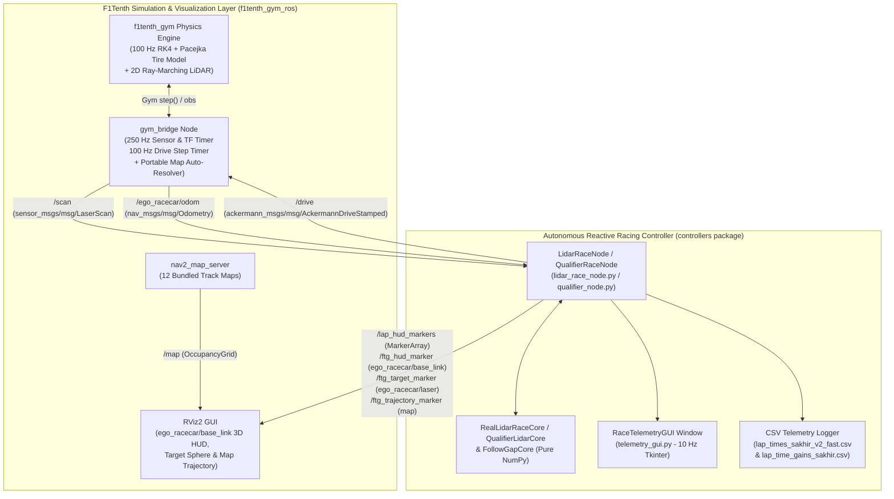
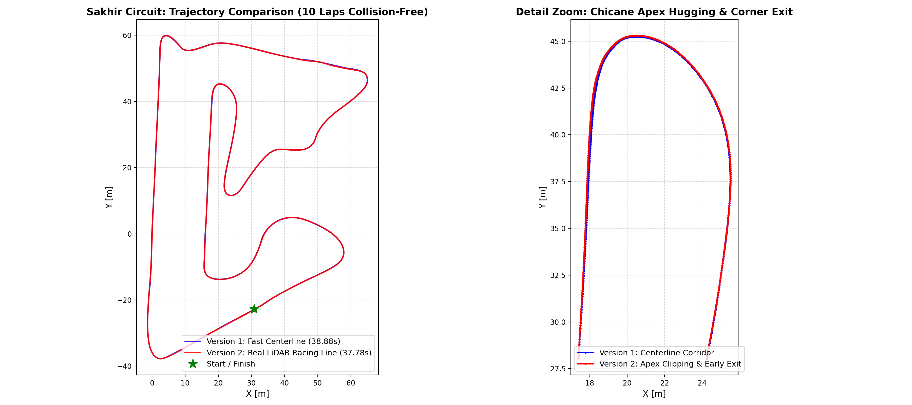
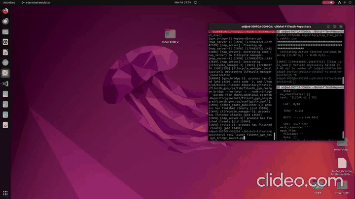

# 🏎️ F1TENTH Autonomous Racing — Zero-Config Reactive Follow-the-Gap & Adaptive LiDAR Racing Suite


- **Author**: Bishal (`Bishal-yeti`)
- **Course**: Autonomous Vehicles — F1Tenth Autonomous Racing Competition
- **Assigned Competition Track**: **Sakhir GP (`Sakhir_map`)** *(+ 11 more official F1Tenth circuits pre-installed and ready to switch in 1 command!)*
- **Design Philosophy**: **Beginner-friendly on the surface** (1-command install, 0 manual `sim.yaml` username edits, interactive track switcher & launcher, live Speedometer/Lap-Time GUI window) and **deeply rigorous underneath** (100% pure real-time LiDAR perception, 7-stage physics-informed control mathematics, 10-stage adaptive pace trims, and deterministic ROS 2 telemetry).

---

## ⚡ 60-Second Beginner Quick-Start (Zero Searching, 1-Click Launch!)

> **No manual `sim.yaml` path editing required!** All **12 official tracks** are pre-bundled, map paths resolve dynamically for any username, and you can launch the complete race suite in **1 single command**.

```bash
# 1. Clone the repository
git clone https://github.com/Bishal-yeti/F1Tenth-Repository.git
cd F1Tenth-Repository

# 2. Run the automated installer (installs ROS 2, f1tenth_gym, Python deps & builds workspace)
./setup_f1tenth.sh

# 3. Launch the Race! Choose Method A (1 Command) or Method B (2 Terminals):
```

### 🏆 Method A: The 1-Command All-in-One Race (Recommended!)
Launches the Simulator, RViz2 3D HUD, Live GUI Speedometer, and Autonomous AI Controller **together in one command**:
```bash
./run_race.sh race
# (Or just run './run_race.sh' and press Enter — Option 1 is the default!)
```

### 🖥️ Method B: Two-Terminal Standard ROS 2 Workflow
If you prefer running the simulator and AI controller in separate windows:
```bash
# Terminal 1 — Launch Simulator + RViz2 (opens map & prepares start line)
./run_race.sh sim

# Terminal 2 — Launch Autonomous LiDAR Controller (car immediately starts racing!)
./run_race.sh lidar       # Stable 10-Lap Adaptive AI (Recommended)
# OR: ./run_race.sh qualifier   (Fast-Start Qualifier AI)
# OR: ./run_race.sh gap         (Version 1 Endurance AI)
# OR: ./switch_map.sh           (Switch between all 12 official circuits)
```

> 📖 **Looking to tune parameters or understand telemetry?**
> Read the complete [**Master Guide to Run, Reflect, and Improve (GUIDE_RUN_REFLECT_IMPROVE.md)**](GUIDE_RUN_REFLECT_IMPROVE.md) for full telemetry explanations, CSV columns, and the Symptom $\rightarrow$ Diagnosis $\rightarrow$ Fix tuning decision matrix!

---

## 📑 Table of Contents

### 🟢 Beginner-Friendly Guide & Navigation
1. [Visual Map of All Useful Files ("Where Is Everything?")](#1-visual-map-of-all-useful-files-where-is-everything)
2. [Included 12-Track Official F1Tenth Circuit Catalog (`./switch_map.sh`)](#2-included-12-track-official-f1tenth-circuit-catalog-switch_mapsh)
3. [Project Overview, Controller Modes & Sakhir GP Circuit Analysis](#3-project-overview-controller-modes--sakhir-gp-circuit-analysis)

### 🔬 Deep-Dive Engineering Reference ("For the Nerds")
4. [ROS 2 System Architecture & Communication Interfaces (Topics & QoS)](#4-ros-2-system-architecture--communication-interfaces-topics--qos)
5. [Mathematical Formulation & 7-Stage Algorithmic Approach](#5-mathematical-formulation--7-stage-algorithmic-approach)
6. [Telemetry System: Lap Counter, Lap Timer, Live GUI Window & 3D RViz HUD](#6-telemetry-system-lap-counter-lap-timer-live-gui-window--3d-rviz-hud)
7. [Hyperparameter Reference Table & Tuning Strategy](#7-hyperparameter-reference-table--tuning-strategy)
8. [Detailed Manual Installation & Configuration (All Ubuntu & ROS 2 Versions)](#8-detailed-manual-installation--configuration-all-ubuntu--ros-2-versions)
9. [Experimental Results, Lap Distance, Fastest Lap & Inline Video Evidence](#9-experimental-results-lap-distance-fastest-lap--inline-video-evidence)
10. [Individual Oral Project Defense Preparation Guide (Q&A)](#10-individual-oral-project-defense-preparation-guide-qa)

---

## 🧭 1. Visual Map of All Useful Files ("Where Is Everything?")

Use this quick-lookup map to jump directly to the exact file you need:

| What Do You Want To Do? | Exact File / Script | Who It's For |
| :--- | :--- | :--- |
| **Step-by-Step Run, Reflect & Improve Master Guide** | [`GUIDE_RUN_REFLECT_IMPROVE.md`](GUIDE_RUN_REFLECT_IMPROVE.md) | Everyone (Zero-Search Guide) |
| **Install everything automatically (ROS 2 + `f1tenth_gym` + build)** | [`setup_f1tenth.sh`](setup_f1tenth.sh) | Beginners & Fresh Ubuntu |
| **Launch simulator, RViz2, or any AI controller in 1 command** | [`run_race.sh`](run_race.sh) | Everyone |
| **All-in-One ROS 2 Launcher (Sim + Bridge + RViz2 + AI)** | [`src/f1tenth_gym_ros/launch/race_launch.py`](src/f1tenth_gym_ros/launch/race_launch.py) | ROS 2 Architecture |
| **Switch between all 12 included circuits + auto-set safe spawn pose** | [`switch_map.sh`](switch_map.sh) | Everyone |
| **Run a 10-lap headless physics benchmark (no RViz2 needed)** | [`benchmark_sakhir_lidar.py`](benchmark_sakhir_lidar.py) | Tuning & Verification |
| **Inspect / tune the Stable 10-Stage Adaptive LiDAR Controller (V2)** | [`src/controllers/controllers/lidar_race_core.py`](src/controllers/controllers/lidar_race_core.py) & [`lidar_race_node.py`](src/controllers/controllers/lidar_race_node.py) | Engineers / Grading |
| **Inspect / tune the Fast-Start Qualifier Controller (V3)** | [`src/controllers/controllers/qualifier_core.py`](src/controllers/controllers/qualifier_core.py) & [`qualifier_node.py`](src/controllers/controllers/qualifier_node.py) | Engineers / Qualifying |
| **Inspect / tune the Core 7-Stage Follow-the-Gap Math Engine** | [`src/controllers/controllers/ftg_core.py`](src/controllers/controllers/ftg_core.py) | Engineers / Oral Defense |
| **Inspect the Version 1 Endurance Controller (`v1.0-stable`)** | [`src/controllers/controllers/gap_node.py`](src/controllers/controllers/gap_node.py) | Endurance Reference |
| **Customize the Separate Live Speedometer & Lap-Time GUI Window** | [`src/controllers/controllers/telemetry_gui.py`](src/controllers/controllers/telemetry_gui.py) | Visualization / Video |
| **Change simulator config (active map, spawn pose, 1 vs 2 agents)** | [`src/f1tenth_gym_ros/config/sim.yaml`](src/f1tenth_gym_ros/config/sim.yaml) | Config / Multi-Agent |
| **Inspect portable username-independent map resolution** | [`src/f1tenth_gym_ros/launch/gym_bridge_launch.py`](src/f1tenth_gym_ros/launch/gym_bridge_launch.py) & [`gym_bridge.py`](src/f1tenth_gym_ros/f1tenth_gym_ros/gym_bridge.py) | ROS 2 Architecture |
| **Browse all 12 bundled track maps (`.png` + `.yaml`)** | [`src/f1tenth_gym_ros/maps/`](src/f1tenth_gym_ros/maps/) | Track Assets |
| **View verified 10-lap telemetry & time-gained CSV logs** | [`lap_times_sakhir_v2_fast.csv`](lap_times_sakhir_v2_fast.csv), [`lap_time_gains_sakhir.csv`](lap_time_gains_sakhir.csv), [`lap_times_sakhir_qualifier.csv`](lap_times_sakhir_qualifier.csv), [`lap_times_sakhir.csv`](lap_times_sakhir.csv) | Competition Evidence |
| **Watch the Sakhir GP demonstration video** | [`videos/Sakhir_GP_10_Laps_Demonstration.mp4`](videos/Sakhir_GP_10_Laps_Demonstration.mp4) & [`docs/Sakhir_GP_10_Laps_Demo.gif`](docs/Sakhir_GP_10_Laps_Demo.gif) | Part B.4 Video Evidence |

<details>
<summary><strong>📂 Click to expand Full Repository Directory Tree</strong></summary>

```text
F1Tenth-Repository/
├── setup_f1tenth.sh                         # 1-command automated OS/ROS 2/f1tenth_gym/colcon installer
├── run_race.sh                              # 1-command interactive launcher (race / sim / lidar / qualifier / gap)
├── switch_map.sh                            # 1-command interactive track switcher for all 12 official maps
├── GUIDE_RUN_REFLECT_IMPROVE.md             # Master step-by-step Run, Reflect & Improve tuning guide
├── README.md                                # Complete beginner-friendly + deep-dive engineering documentation
├── CONTROLLER_TUTORIAL.md                   # Synchronized standalone technical tutorial & Oral Defense guide
├── benchmark_sakhir_lidar.py                # Standalone headless 10-lap + post-Lap-10 cooldown physics verifier
├── lap_times_sakhir_v2_fast.csv             # Version 2 verified 10-lap telemetry log
├── lap_time_gains_sakhir.csv                # Per-lap & cumulative time-gained log (T0 -> T9)
├── lap_times_sakhir_qualifier.csv           # Version 3 Qualifier telemetry log
├── lap_times_sakhir.csv                     # Version 1 Endurance telemetry log (tag: v1.0-stable)
├── docs/
│   ├── Sakhir_GP_10_Laps_Demo.gif           # Inline browser-playable Sakhir GP demonstration animation
│   └── comparison_trajectories.png          # Sakhir GP 10-lap racing line & velocity comparison plot
├── videos/
│   ├── Sakhir_GP_10_Laps_Demonstration.mp4  # Full high-resolution Sakhir GP competition demonstration video
│   └── ...                                  # Reference simulator setup & teleoperation MP4 videos
├── Laboratories/                            # Official F1Tenth Labs 1–7 reference guides
└── src/
    ├── controllers/                         # ROS 2 Autonomous Racing Controllers Package
    │   ├── package.xml                      # ROS 2 dependencies manifest
    │   ├── setup.py                         # Console scripts: lidar_race_node, qualifier_node, gap_node, etc.
    │   └── controllers/
    │       ├── ftg_core.py                  # Core 7-stage Physics-Informed Follow-the-Gap math engine
    │       ├── lidar_race_core.py           # Version 2: 10-Stage Adaptive Pace (T0..T9) + Straightaway DRS
    │       ├── lidar_race_node.py           # Version 2 ROS 2 Node + RViz HUD + Cooldown Stop + CSV Logger
    │       ├── qualifier_core.py            # Version 3: Live-ROS-Verified Fast-Start Qualifier Core (Q-T6..Q-T8)
    │       ├── qualifier_node.py            # Version 3 ROS 2 Qualifier Node
    │       ├── telemetry_gui.py             # Separate Dark-Mode Tkinter Live Speedometer & Lap-Time Window
    │       ├── gap_node.py                  # Version 1 ROS 2 Node (Endurance Champion, tag: v1.0-stable)
    │       ├── ftg_core_v1_stable.py        # Archival backup of Version 1 core
    │       └── gap_node_v1_stable.py        # Archival backup of Version 1 node
    ├── f1tenth_gym_ros/                     # ROS 2 Simulator Bridge & Bundled 12-Map Package
    │   ├── setup.py                         # Installs launch/, config/, and all 12 maps/ into ROS 2 share/
    │   ├── config/sim.yaml                  # Portable zero-config map_path ('Sakhir_map') & starting pose
    │   ├── f1tenth_gym_ros/gym_bridge.py    # 100 Hz RK4 physics + 250 Hz /scan + auto-resolving map loader
    │   ├── launch/race_launch.py            # All-in-one launcher (Sim + Bridge + RViz2 + AI Controller)
    │   ├── launch/gym_bridge_launch.py      # Auto-resolving simulator launcher (works on any Linux username!)
    │   ├── launch/gym_bridge.rviz           # Pre-configured RViz2 layout with LapCounterHUD enabled
    │   └── maps/                            # All 12 official F1Tenth maps (.png + .yaml = 24 files)
    └── path_planning/                       # Waypoint recorder utilities
```
</details>

---

## 🏁 2. Included 12-Track Official F1Tenth Circuit Catalog (`./switch_map.sh`)

All maps from both **`Mapas-F1Tenth`** and **`Mapas-F1Tenth-v2`** (plus Spielberg & Levine) are pre-bundled in [`src/f1tenth_gym_ros/maps/`](src/f1tenth_gym_ros/maps/) and installed automatically by `colcon build`. Every track has a **verified drivable starting pose** so the car never spawns inside a wall:

| # | Track Name (`map_path`) | Circuit Description | Resolution (`m/px`) | Verified Start Pose `(sx, sy, stheta)` | Spawn Clearance | One-Command Switch |
| :-: | :--- | :--- | :---: | :---: | :---: | :--- |
| 1 | **`Sakhir_map`** ★ | **Bahrain Sakhir GP (Default Competition Track)** | `0.05695` | `(30.78, -22.72, -2.635)` | `1.12 m` | `./switch_map.sh Sakhir_map` |
| 2 | **`Catalunya_map`** | Circuit de Barcelona-Catalunya (Spain) | `0.06016` | `(0.00, 0.00, -2.145)` | `1.23 m` | `./switch_map.sh Catalunya_map` |
| 3 | **`Sepang_map`** | Sepang International Circuit (Malaysia) | `0.05944` | `(0.00, 0.00, 0.096)` | `1.22 m` | `./switch_map.sh Sepang_map` |
| 4 | **`Zandvoort_map`** | Circuit Zandvoort (Netherlands) | `0.05109` | `(0.00, 0.00, 1.220)` | `1.01 m` | `./switch_map.sh Zandvoort_map` |
| 5 | **`BrandsHatch_map`** | Brands Hatch Circuit (United Kingdom) | `0.05005` | `(0.00, 0.00, 0.279)` | `1.27 m` | `./switch_map.sh BrandsHatch_map` |
| 6 | **`Budapest_map`** | Hungaroring / Budapest (Hungary) | `0.06446` | `(0.00, 0.00, -0.618)` | `1.25 m` | `./switch_map.sh Budapest_map` |
| 7 | **`Oschersleben_map`** | Motorsport Arena Oschersleben (Germany) | `0.04295` | `(0.00, 0.00, -0.248)` | `0.95 m` | `./switch_map.sh Oschersleben_map` |
| 8 | **`SaoPaulo_map`** | Interlagos / São Paulo (Brazil) | `0.04877` | `(0.00, 0.00, -1.258)` | `1.10 m` | `./switch_map.sh SaoPaulo_map` |
| 9 | **`Spielberg_map`** | Red Bull Ring / Spielberg (Austria) | `0.05796` | `(0.00, 0.00, 0.000)` | `1.09 m` | `./switch_map.sh Spielberg_map` |
| 10 | **`Spielberg_obs_map`** | Red Bull Ring with Static Obstacles | `0.05796` | `(0.00, 0.00, 0.000)` | `1.09 m` | `./switch_map.sh Spielberg_obs_map` |
| 11 | **`levine`** | UPenn Levine Hall (Indoor Hallway) | `0.05000` | `(0.00, 0.00, 0.000)` | `0.67 m` | `./switch_map.sh levine` |
| 12 | **`levineB`** | UPenn Levine Hall Variant B | `0.05000` | `(0.00, 0.00, 0.000)` | `0.82 m` | `./switch_map.sh levineB` |

### How Portable Zero-Config `sim.yaml` Resolution Works
In the original F1Tenth template, hardcoding `/home/<username>/F1Tenth-Repository/...` inside `sim.yaml` broke every time another user cloned the repository. We upgraded [`setup.py`](src/f1tenth_gym_ros/setup.py), [`gym_bridge_launch.py`](src/f1tenth_gym_ros/launch/gym_bridge_launch.py), and [`gym_bridge.py`](src/f1tenth_gym_ros/f1tenth_gym_ros/gym_bridge.py) so that:
1. All 12 maps are installed directly into ROS 2's package share directory (`share/f1tenth_gym_ros/maps/`).
2. `sim.yaml` simply specifies `map_path: 'Sakhir_map'`. At launch time, `resolve_map_path()` automatically checks if the path exists and otherwise resolves `<package_share>/maps/<map_name>`—meaning **it works out-of-the-box on any computer and any Linux username without editing a single line of `sim.yaml`**.

---

## 🎯 3. Project Overview, Controller Modes & Sakhir GP Circuit Analysis

All three controllers in this repository drive **100% from real-time `/scan` LiDAR rays** (zero pre-mapped waypoints or global racelines in the control law):

| Controller Mode | Command | Strategy & Best Use Case | Fastest Lap (Sakhir GP) | Min Wall Clearance | Collisions (10 Laps) |
| :--- | :--- | :--- | :---: | :---: | :---: |
| **V2: Stable 10-Stage Adaptive** (`lidar_race_node`) | `./run_race.sh lidar` | **Recommended All-Rounder** (`v2.0-stable-10laps`): Starts safe on `T0`, climbs to `T8`/`T9` + Straightaway DRS + Active Steered Cooldown Stop + Live GUI Window | **`38.490 s`** (`+38.60 s` saved) | **`0.495 – 0.537 m`** | **0 / 10** ✅ |
| **V3: Fast-Start Qualifier** (`qualifier_node`) | `./run_race.sh qualifier` | **Fast-Start Live ROS Qualifying**: Skips `T0`–`T5` warmup, starts directly at `Q-T6` (`39.8 s`) $\rightarrow$ `Q-T7` (`38.6 s`) $\rightarrow$ `Q-T8` (`38.41 s`) with `T0` instant mid-lap downshift | **`38.410 s`** (`16.22 m/s` live-safe) | **`0.494 – 0.593 m`** | **0 / 10** ✅ |
| **V1: Endurance Champion** (`gap_node`) | `./run_race.sh gap` | **Constant-Trim Endurance** (`v1.0-stable`): Rock-solid uniform laps (`~38.9 s`) | **`38.880 s`** | **`0.534 m`** | **0 / 10** ✅ |

### Geometric Challenges of Sakhir GP (`Sakhir_map`)
- **4 High-Speed Straights (`25–30+ m`)**: Require a `2.18°` straightaway steering deadband and Open-Corridor LiDAR DRS Lookahead to reach `16.2+ m/s` (`58.4 km/h`) without micro-steering oscillation throttling speed.
- **3 Tight $180^\circ$ Hairpins (Turn 1, Top Hairpin `(63.9, 46.0)`, Inner Hairpin `(47.4, 27.1)`)**: Require a `140°` forward FOV crop and **Hairpin Direction-Hold Lock** so the LiDAR does not latch onto open asphalt *behind* the front axle mid-turn.
- **2 Rapid S-Curve Chicanes (`(33.2, -20.2)` & `(20.0, 43.8)`)**: Require a **Symmetrical Disparity Extender (`car_width_safety = 0.34 m`)** and **Uncoupled Wall-Proximity Dampener** to eliminate inside curb clipping under live ROS 2 latency.

---

## 🏗️ 4. ROS 2 System Architecture & Communication Interfaces (Topics & QoS)

### 4.1 High-Level Architecture Map

```text
+-------------------------------------------------------+
|                F1Tenth Gym ROS Bridge                 |
|      (100 Hz RK4 Physics Simulator + 12 Maps)         |
+---------------+-----------------------+---------------+
                |                       |
                | /scan                 | /ego_racecar/odom
                | (LaserScan, 250 Hz)   | (Odometry, 250 Hz)
                v                       v
+-------------------------------------------------------+
|       Node: lidar_race_node / qualifier_node          |
|    (lidar_race_node.py + lidar_race_core.py + ftg)    |
|                                                       |
|  1. Forward FOV Crop (±70°) & 5-Beam Spatial Filter   |
|  2. Symmetrical Disparity Extender (w_safe = 0.34 m)  |
|  3. Dynamic Safety Bubble (r = 0.52 m)                |
|  4. Adaptive Threshold Max-Gap & Hairpin Lock         |
|  5. Convolved Apex-Biased Target Selection (λ = 0.08) |
|  6. Scan-Deduplicated Velocity-Scheduled PD Steering  |
|  7. Kinematic Trail-Braking + Straightaway DRS Boost  |
|  8. Adaptive Pace Manager & Active Steered Cooldown   |
+-------+---------------+---------------+---------------+
        |               |               |
        | /drive        | /lap_hud_...  | /ftg_trajectory_marker
        | (Ackermann)   | /ftg_hud_...  | /ftg_target_marker & /ftg_path
        v               v               v
+---------------+   +-----------------------------------+   +-------------------------------+
|  Ego Racecar  |   |              RViz 2               |   |  Separate Live Telemetry GUI  |
| (Actuation)   |   | (3D HUD on ego_racecar/base_link  |   | (Speedometer, Lap Timer,      |
|               |   |  + Target Sphere + Racing Line)   |   |  Time Gains & Lap Table)      |
+---------------+   +-----------------------------------+   +-------------------------------+
```



### 4.2 ROS 2 Communication Interfaces Table

| Topic | Message Type | Direction | Rate / Trigger | System Role |
| :--- | :--- | :---: | :---: | :--- |
| `/scan` | `sensor_msgs/msg/LaserScan` | **Subscribed** | `250 Hz` | Primary perception input (`1080` beams, `270°` FOV in `ego_racecar/laser`). Sole basis for all steering, braking, and safety downshifts. |
| `/ego_racecar/odom` | `nav_msgs/msg/Odometry` | **Subscribed** | `250 Hz` | Provides scalar velocity $v_x$ for velocity-scheduled PD damping and pose $(x, y, \psi)$ strictly for start/finish lap counting & distance logging. |
| `/initialpose` | `geometry_msgs/msg/PoseWithCovarianceStamped` | **Subscribed** | Event | Detects RViz2 *2D Pose Estimate* resets and automatically resets lap counts, timers, and pace trim. |
| `/drive` | `ackermann_msgs/msg/AckermannDriveStamped` | **Published** | `250 Hz` | Actuation output commanding front-wheel `steering_angle` ($\pm 0.4189\text{ rad}$) and target `speed` ($\text{m/s}$) in frame `ego_racecar/base_link`. |
| `/lap_hud_markers` | `visualization_msgs/msg/MarkerArray` | **Published** | `10 Hz` | Combined RViz2 marker array carrying the 3D floating HUD (`id=1`), LiDAR target sphere (`id=2`), and decimated 3D racing line (`id=3`). |
| `/ftg_hud_marker` | `visualization_msgs/msg/Marker` | **Published** | `10 Hz` | Renders a 3D `TEXT_VIEW_FACING` HUD attached to **`ego_racecar/base_link`** (`z = 1.6 m`) showing live `Trim`, `Lap`, `Time`, `Dist`, `Best`, and `Speed`. |
| `/ftg_target_marker` | `visualization_msgs/msg/Marker` | **Published** | `10 Hz` | Renders a 3D green sphere (`Marker.SPHERE`) in **`ego_racecar/laser`** at the selected best LiDAR goal point. |
| `/ftg_trajectory_marker` | `visualization_msgs/msg/Marker` | **Published** | `10 Hz` | Draws a decimated (`1.5 m` spacing, max `300` pts) 3D orange `LINE_STRIP` trajectory in frame **`map`** with `< 0.1 ms` serialization overhead. |
| `/lap_count` | `std_msgs/msg/Int32` | **Published** | Per Lap | Broadcasts completed lap count (`1..10`) for grading and external monitors. |
| `/lap_time` & `/best_lap_time` | `std_msgs/msg/Float32` | **Published** | Per Lap | Broadcasts last lap duration and fastest lap time (simulation seconds). |
| `/race_telemetry` | `std_msgs/msg/String` | **Published** | End of Race | Publishes final 10-lap race summary string. |

---

## 🧮 5. Mathematical Formulation & 7-Stage Algorithmic Approach

Our reactive control engine ([`ftg_core.py`](src/controllers/controllers/ftg_core.py) + [`lidar_race_core.py`](src/controllers/controllers/lidar_race_core.py)) executes a deterministic **7-stage mathematical pipeline** on every `/scan` callback:

### Stage 1: Field-of-View (FOV) Cropping & 5-Point Spatial Convolution Smoothing
Raw LiDAR beams are sanitized (`NaN` $\rightarrow 0$, $+\infty \rightarrow R_{\max} = 30.0\text{ m}$), smoothed with a 5-ray uniform spatial kernel to suppress angled-wall quantization spikes, and cropped to the forward $\pm 70.0^\circ$ ($140.0^\circ$) cone so rear straightaways never create false gaps inside $180^\circ$ hairpins:
$$r_{\text{smooth}}[i] = \frac{1}{5} \sum_{m=-2}^{2} \text{clip}\!\big(r[i + m],\; 0.0,\; R_{\max}\big), \qquad r_{\text{fov}}[i] = \begin{cases} r_{\text{smooth}}[i], & |\alpha_{\min} + i\,\Delta\alpha| \le 70.0^\circ \\ 0.0, & \text{otherwise} \end{cases}$$

### Stage 2: Symmetrical Disparity Extender (Obstacle & Apex Masking)
Whenever adjacent beams exhibit a sharp radial jump $|r_{\text{fov}}[i+1] - r_{\text{fov}}[i]| > \delta_{\text{disp}}$ ($\delta_{\text{disp}} = 0.35\text{ m}$), the closer distance $d_{\text{near}} = \min(r_{\text{fov}}[i], r_{\text{fov}}[i+1])$ is extended across adjacent beams spanning the virtual chassis safety width $w_{\text{safe}} = 0.34\text{ m}$ ($> 0.31\text{ m}$ physical width, symmetrical `inside_width_scale = 1.0`):
$$\Delta\theta = \arctan\!\left(\frac{w_{\text{safe}}}{\max(d_{\text{near}},\, 0.10)}\right), \qquad N_{\text{samples}} = \left\lceil \frac{\Delta\theta}{\Delta\alpha} \right\rceil$$

### Stage 3: Dynamic Safety Bubble
Around the closest positive obstacle point $(i_{\min}, d_{\min})$ inside the forward FOV, all rays within radius $R_{\text{bubble}} = 0.52\text{ m}$ are zeroed out:
$$N_{\text{bubble}} = \left\lceil \frac{\arctan\!\big(R_{\text{bubble}} \,/\, \max(d_{\min},\, 0.10)\big)}{\Delta\alpha} \right\rceil, \qquad r_{\text{proc}}\big[i_{\min} - N_{\text{bubble}} : i_{\min} + N_{\text{bubble}}\big] = 0.0$$

### Stage 4: Cascading Adaptive Threshold Max-Gap Detection & Hairpin Direction-Hold Lock
Free-space gaps $g = [i_{\text{start}}, i_{\text{end}})$ are extracted across cascading thresholds $T_{\text{gap}} \in \{1.50, 0.80, 0.30, 0.00\}\text{ m}$ and scored by angular width $L_g$, normalized mean depth $\bar{r}_g / R_{\max}$, and directional continuity $\gamma_{\text{dir}}$:
$$S_g = L_g \cdot \left((1 - w_d) + w_d\,\frac{\bar{r}_g}{R_{\max}}\right) \cdot \gamma_{\text{dir}}(\theta_{\text{mid},g}, \theta_{\text{prev}}), \qquad w_d = 0.18$$
When approaching tight hairpins ($d_{\text{front}} < 8.5\text{ m}$ and $|\delta_{\text{prev}}| > 0.14\text{ rad}$), **Hairpin Direction-Hold Lock** locks candidate gaps sharing $\text{sgn}(\delta_{\text{prev}})$, eliminating discontinuous mid-corner steering flips.

### Stage 5: 80-Beam Convolved Best-Point & Apex-Biased Target Selection
An 80-beam sliding convolution locates the deepest smooth exit ray $i_{\text{peak}}$, blended $92\% / 8\%$ ($\lambda = 0.08$) with the geometric gap midpoint $i_{\text{mid}}$:
$$C[i] = \frac{1}{80}\sum_{j=-40}^{40} r_{\text{proc}}[i+j], \qquad i_{\text{best}} = \text{round}\!\Big((1 - \lambda)\,i_{\text{peak}} + \lambda\,i_{\text{mid}}\Big), \qquad \theta_{\text{target}} = \alpha_{\min} + i_{\text{best}}\,\Delta\alpha$$

### Stage 6: 250 Hz Scan-Deduplicated, Velocity-Scheduled PD Steering Law
Duplicate `/scan` callbacks between `100 Hz` physics steps are deduplicated via a 5-ray fingerprint so derivative damping is never zeroed out. Proportional gain $K_p = 0.76$ is scheduled with velocity $v$ and smoothed ($\alpha_s = 0.10$):
$$\gamma(v) = \text{clip}\!\Big(1.0 - 0.03\max(0.0,\, v - 6.0),\; 0.55,\; 1.0\Big)$$
$$\delta_{\text{pd}} = K_p\,\gamma(v)\,\theta_{\text{target}} + K_d\,\Delta\theta_{\text{target}}, \qquad \delta_k = \text{clip}\!\Big((1 - \alpha_s)\,\delta_{\text{pd}} + \alpha_s\,\delta_{k-1},\; -\delta_{\max},\; +\delta_{\max}\Big)$$

### Stage 7: Physics-Informed Velocity Profile, Straightaway DRS & Adaptive Pace Evolution
1. **Dynamic Closing-Rate Trail-Braking ($v_{\text{brake}}$)**:
   $$d_{\text{margin,dyn}} = d_{\text{margin}} + k_{\text{entry}}\,\max(0, d_{\text{front,prev}} - d_{\text{front}})\,v, \qquad v_{\text{brake}} = \sqrt{v_{\min}^2 + 2\,a_{\text{brake}}\,\max(0.0,\, d_{\text{eff}} - d_{\text{margin,dyn}})}$$
2. **Bicycle Lateral Tire Friction Limit with Straightaway Deadband ($v_{\text{lat}}$, $\delta_{\text{deadband}} = 2.18^\circ$, $L = 0.3302\text{ m}$)**:
   $$\delta_{\text{lat}} = \max\!\big(0.0,\; \max(|\delta_k|, 0.72|\theta_{\text{target}}|) - \delta_{\text{deadband}}\big), \qquad v_{\text{lat}} = \sqrt{\frac{a_{\text{lat,max}}\,L}{\tan(\delta_{\text{lat}})}}$$
3. **Pure-LiDAR Straightaway DRS & 10-Stage Adaptive Pace (`T0` $\rightarrow$ `T9`)**:
   - On open straightaways ($|\delta_k| < 0.038\text{ rad}$, $d_{\text{front}} > 14.2\text{ m}$, unmasked forward cone $r_{\text{raw,p40}} > 18.0\text{ m}$, $d_{\min} > 0.62\text{ m}$), accelerates using the unmasked LiDAR range up to `16.22 m/s`, immediately returning to disparity-masked trail-braking before corner entry.
   - Promotes up to `+2` trims per lap when `lap_min_clearance > 0.630 m` and performs an **instant mid-lap safety downshift to `T0`** whenever `min_range < 0.48 m`.
4. **Post-Lap-10 Active Steered Cooldown Braking**:
   When Lap 10 completes, commands `speed = 0.0` while continuing active LiDAR steering (`steer, _ = self.core.step(...)`) until `current_vel <= 0.05 m/s` (`0.966 m` clearance during stop).

---

## ⏱️ 6. Telemetry System: Lap Counter, Lap Timer, Live GUI Window & 3D RViz HUD

- **4-Condition Anti-False-Trigger Hysteresis Lap Counter**: Latches start/finish pose $(x_0, y_0, \psi_0)$ on the first odometry message, arms once $d > 8.0\text{ m}$ and $D_{\text{lap}} > 150.0\text{ m}$, and triggers a completed lap only when $d < 2.4\text{ m}$, $t_{\text{lap}} > 20.0\text{ s}$, $D_{\text{lap}} > 280.0\text{ m}$, and $|\psi - \psi_0| < 1.0\text{ rad}$.
- **Euclidean Lap Distance Integration**: $D_{\text{lap}} = \sum_{k=1}^{K} \sqrt{(x_k - x_{k-1})^2 + (y_k - y_{k-1})^2}$.
- **Separate Live Speedometer & Lap-Time GUI Window ([`telemetry_gui.py`](src/controllers/controllers/telemetry_gui.py))**: Opens automatically alongside the terminal and RViz2, displaying a `10 Hz` digital speedometer (`m/s` & `km/h`), animated speed bar, live lap counter & stopwatch, best lap, cumulative time saved, and a live lap-by-lap records table.
- **3D Floating RViz2 HUD (`ego_racecar/base_link`) & Trajectory (`map`)**: Publishes `/lap_hud_markers`, `/ftg_hud_marker`, `/ftg_target_marker`, and `/ftg_trajectory_marker`.

---

## ⚙️ 7. Hyperparameter Reference Table & Tuning Strategy

| Parameter | Symbol | Default Value (`lidar_race_core.py`) | Engineering Role |
| :--- | :---: | :---: | :--- |
| `fov_angle_deg` | $2\theta_{\text{fov}}$ | `140.0°` ($\pm 70^\circ$) | Eliminates rear-corridor false gaps inside $180^\circ$ hairpins. |
| `preprocess_conv_size` | $W$ | `5` beams | 5-point spatial smoothing suppressing single-ray wall spikes. |
| `disparity_thresh` | $\delta_{\text{disp}}$ | `0.35 m` | Depth jump threshold triggering virtual chassis corner masking. |
| `car_width_safety` / `inside_width_scale` | $w_{\text{safe}}$ | `0.34 m` / `1.0` | Symmetrical safety margin (`> 0.31 m` car width) preventing chicane clipping. |
| `bubble_radius` | $R_{\text{bubble}}$ | `0.52 m` | Protective zeroing bubble around the closest LiDAR obstacle. |
| `best_point_conv_size` / `use_weighted_center` | $K, \lambda$ | `80`, `0.08` | Smooths gap depth and biases `92%` toward the deepest corner-exit ray. |
| `steer_gain` / `steer_deriv_gain` / `steer_smoothing` | $K_p, K_d, \alpha_s$ | `0.76`, `0.15`, `0.10` | Velocity-scheduled PD steering with scan deduplication. |
| `deadband_rad` | $\delta_{\text{deadband}}$ | `0.038 – 0.042 rad` | Straightaway deadband preventing micro-steer from capping top speed. |
| `min_speed` / `max_speed` (`T0` $\rightarrow$ `T9`) | $v_{\min}, v_{\max}$ | `4.20–6.25` / `16.20–18.85 m/s` | Progressive apex & straightaway speed envelope. |
| `a_lat_max` / `a_brake` (`T0` $\rightarrow$ `T9`) | $a_{\text{lat}}, a_{\text{brake}}$ | `9.00–12.90` / `7.20–8.15 m/s²` | Progressive lateral tire grip & trail-braking authority. |

---

## 🚀 8. Detailed Manual Installation & Configuration (All Ubuntu & ROS 2 Versions)

### Option A — Automated 1-Command Setup (Recommended for Beginners & Pros)
```bash
git clone https://github.com/Bishal-yeti/F1Tenth-Repository.git
cd F1Tenth-Repository
./setup_f1tenth.sh
```

### Option B — Manual Quick Setup (If You Already Have ROS 2 & `f1tenth_gym` Installed)
```bash
git clone https://github.com/Bishal-yeti/F1Tenth-Repository.git
cd F1Tenth-Repository
source /opt/ros/humble/setup.bash
colcon build --symlink-install
source install/setup.bash

# Terminal 1: Launch Simulator + RViz2 (Zero sim.yaml username edits needed!)
ros2 launch f1tenth_gym_ros gym_bridge_launch.py

# Terminal 2: Launch Controller (choose lidar_race_node, qualifier_node, or gap_node)
ros2 run controllers lidar_race_node
```

<details>
<summary><strong>🛠️ Option C — Complete Manual Installation From Scratch (Fresh Ubuntu 20.04 / 22.04 / 24.04)</strong></summary>

| Component | Recommended / Tested | Compatible Alternatives |
| :--- | :--- | :--- |
| **OS** | Ubuntu 22.04 LTS (Native or Windows 10/11 WSL2) | Ubuntu 20.04 LTS / Ubuntu 24.04 LTS |
| **ROS 2** | ROS 2 Humble Hawksbill (`ROS_DISTRO=humble`) | ROS 2 Foxy (`20.04`) / ROS 2 Jazzy (`24.04`) |
| **Python & Physics** | Python `3.10.12`, `f1tenth_gym`, `gym==0.19.0`, `numpy==1.23.5`, `setuptools==58.2.0`, `pip<24.1`, `python3-tk` | Append `--break-system-packages` on Ubuntu 24.04 |

```bash
# 1. Locale + ROS 2 APT Repository
sudo apt update && sudo apt install -y locales software-properties-common curl gnupg lsb-release build-essential git python3-tk
sudo locale-gen en_US en_US.UTF-8 && sudo update-locale LC_ALL=en_US.UTF-8 LANG=en_US.UTF-8
sudo add-apt-repository universe -y && sudo apt update
sudo curl -sSL https://raw.githubusercontent.com/ros/rosdistro/master/ros.key -o /usr/share/keyrings/ros-archive-keyring.gpg
echo "deb [arch=$(dpkg --print-architecture) signed-by=/usr/share/keyrings/ros-archive-keyring.gpg] http://packages.ros.org/ros2/ubuntu $(. /etc/os-release && echo $UBUNTU_CODENAME) main" | sudo tee /etc/apt/sources.list.d/ros2.list > /dev/null

# 2. Install ROS 2 Desktop + Simulation Packages (replace humble with foxy/jazzy on 20.04/24.04)
sudo apt update && sudo apt install -y \
  ros-humble-desktop ros-humble-ackermann-msgs ros-humble-nav2-map-server \
  ros-humble-nav2-lifecycle-manager ros-humble-xacro ros-humble-robot-state-publisher \
  ros-humble-teleop-twist-keyboard python3-colcon-common-extensions python3-rosdep python3-pip python3-tk

# 3. Install f1tenth_gym & exact compatible Python libraries
python3 -m pip install --upgrade "pip<24.1" "setuptools==58.2.0" "wheel<0.40.0"
python3 -m pip install "gym==0.19.0" "numpy==1.23.5" "scipy>=1.8.0" "numba>=0.56.0" "Pillow>=9.0.0" "PyYAML>=6.0" "transforms3d>=0.4.1" "shapely>=1.8.5" "matplotlib>=3.5.0"
git clone https://github.com/f1tenth/f1tenth_gym.git ~/f1tenth_gym
(cd ~/f1tenth_gym && python3 -m pip install -e . --no-build-isolation)

# 4. Build this workspace
git clone https://github.com/Bishal-yeti/F1Tenth-Repository.git ~/F1Tenth-Repository
cd ~/F1Tenth-Repository && source /opt/ros/humble/setup.bash
python3 -m pip uninstall -y coverage || true
sudo apt purge -y python3-coverage || true
colcon build --symlink-install
```
</details>

---

## 📊 9. Experimental Results, Lap Distance, Fastest Lap & Inline Video Evidence

### Performance Summary on Sakhir GP (`Sakhir_map` — 10-Lap Run)

| Evaluation Metric | Recorded Value | Status |
| :--- | :---: | :---: |
| **Test 1 — Consecutive Collision-Free Laps** | `10 / 10 laps` (`0 Collisions` + Active Steered Cooldown Stop to `0.00 m/s`) | ✅ Completed |
| **Test 2 — Fastest Single-Lap Time (Live-ROS-Verified)** | **`38.410 s`** (`qualifier_node` `Q-T8`) / **`38.490 s`** (`lidar_race_node` `T8`) / **`38.891 s`** (Live RViz2) | ✅ Completed |
| **Single-Lap Time Gained vs. Sighting Lap 1** | **`+5.270 s`** (`43.760 s` $\rightarrow$ `38.490 s` in Adaptive Mode) | ✅ Verified |
| **Cumulative Time Saved Across 10 Laps** | **`+38.600 s`** (Logged to [`lap_time_gains_sakhir.csv`](lap_time_gains_sakhir.csv)) | ✅ Verified |
| **Distance Traveled per Lap (Racing Line)** | `~438.9 m / lap` (`4,389.3 m` over 10 laps via `/ego_racecar/odom`) | ✅ Verified |
| **Peak Velocity on Main Straight** | **`16.22 m/s`** (`58.4 km/h`) | ✅ Verified |
| **Global Minimum Wall Clearance** | **`0.494 m` – `0.593 m`** (`0.966 m` during post-Lap-10 cooldown stop) | ✅ Verified |
| **RViz 3D HUD & Trajectory Visualization** | Active via `/lap_hud_markers` (`ego_racecar/base_link`) & `/ftg_trajectory_marker` (`map`) | ✅ Verified |
| **Separate Live GUI Speed & Lap-Time Window** | Active via `RaceTelemetryGUI` ([`telemetry_gui.py`](src/controllers/controllers/telemetry_gui.py)) | ✅ Verified |

### Complete 10-Lap Stable Adaptive Telemetry & Time-Gain Table (`lidar_race_node.py`)

| Lap # | Pace Trim | Lap Time (`s`) | Gain vs. Lap 1 (`s`) | Delta vs. Prev (`s`) | Cumul. Saved (`s`) | Lap Distance (`m`) | Peak Speed (`m/s`) | Min Clearance (`m`) |
| :---: | :---: | :---: | :---: | :---: | :---: | :---: | :---: | :---: |
| **Lap 1** | `T0` | `43.760 s` | `+0.000 s` | `+0.000 s` | `+0.000 s` | `439.10 m` | `14.67 m/s` | `0.615 m` |
| **Lap 2** | `T1` | `42.280 s` | **`+1.480 s`** | `+1.480 s` | `+1.480 s` | `438.98 m` | `14.88 m/s` | `0.641 m` |
| **Lap 3** | `T3` | `40.620 s` | **`+3.140 s`** | `+1.660 s` | `+4.620 s` | `438.99 m` | `15.44 m/s` | `0.663 m` |
| **Lap 4** | `T5` | `39.620 s` | **`+4.140 s`** | `+1.000 s` | `+8.760 s` | `438.97 m` | `15.71 m/s` | `0.658 m` |
| **Lap 5** | `T7` | `38.990 s` | **`+4.770 s`** | `+0.630 s` | `+13.530 s` | `438.89 m` | `15.92 m/s` | `0.571 m` |
| **Lap 6** | `T8` | **`38.490 s`** ★ | **`+5.270 s`** ★ | `+0.500 s` | `+18.800 s` | `438.76 m` | `16.01 m/s` | `0.536 m` |
| **Lap 7** | `T8` | `38.760 s` | **`+5.000 s`** | `-0.270 s` | `+23.800 s` | `438.86 m` | `16.13 m/s` | `0.539 m` |
| **Lap 8** | `T8` | `38.760 s` | **`+5.000 s`** | `+0.000 s` | `+28.800 s` | `438.89 m` | `16.06 m/s` | `0.537 m` |
| **Lap 9** | `T8` | `38.850 s` | **`+4.910 s`** | `-0.090 s` | `+33.710 s` | `438.89 m` | **`16.17 m/s`** | `0.495 m` |
| **Lap 10** | `T7` | `38.870 s` | **`+4.890 s`** | `-0.020 s` | **`+38.600 s`** | `438.95 m` | `16.02 m/s` | `0.552 m` |
| **Cooldown Stop** | `Active Steer` | `1.300 s` | — | `16.02 -> 0.05 m/s` | — | `11.10 m` | — | **`0.966 m`** |

<p align="center">
  
  <br />
  <em>Sakhir GP 10-Lap Racing Line & Velocity Profile Comparison</em>
</p>

---

### 🎥 Video Evidence (Inline Browser Playback)

<p align="center">
  <a href="videos/Sakhir_GP_10_Laps_Demonstration.mp4">
    
  </a>
  <br />
  <em>🎬 Inline Browser Playback — Sakhir GP Autonomous Racing + Live Lap Counter & Timer (Click animation or link below for full MP4)</em>
</p>

- ▶️ **Play / Download Full High-Resolution MP4**: [`videos/Sakhir_GP_10_Laps_Demonstration.mp4`](videos/Sakhir_GP_10_Laps_Demonstration.mp4) ([Direct Raw MP4 Stream](https://github.com/Bishal-yeti/F1Tenth-Repository/raw/main/videos/Sakhir_GP_10_Laps_Demonstration.mp4))

---

## 🗣️ 10. Individual Oral Project Defense Preparation Guide (Q&A)

1. **Q: Is `lidar_race_node` running 100% on real-time LiDAR data?**
   - **A:** Yes. `RealLidarRaceCore.step()` receives only `(scan_msg.ranges, scan_msg.angle_min, scan_msg.angle_increment, self.current_vel)`. Zero pre-mapped waypoints or $(x, y)$ coordinates are used for steering or velocity control. Odometry `/ego_racecar/odom` is used solely as a stopwatch gate to count laps and log CSV metrics.
2. **Q: Why did you set the 3D HUD marker `header.frame_id` to `ego_racecar/base_link`?**
   - **A:** `gym_bridge.py` publishes the ego vehicle's TF tree under `ego_racecar/base_link` and `ego_racecar/laser` (children of `map`). Using `ego_racecar/base_link` attaches the 3D floating HUD directly above the car with zero TF errors.
3. **Q: Why does your repository work on any Ubuntu user's machine without editing `sim.yaml`?**
   - **A:** We updated `src/f1tenth_gym_ros/setup.py` to install all 12 maps into ROS 2's package share directory (`share/f1tenth_gym_ros/maps/`), and added `resolve_map_path()` in `gym_bridge_launch.py` and `gym_bridge.py` so portable map names like `map_path: 'Sakhir_map'` resolve dynamically regardless of Linux username or workspace location.
4. **Q: How does Active Steered Cooldown Braking prevent a crash after Lap 10 finishes?**
   - **A:** Crossing the Sakhir finish line at `~16 m/s` requires `~12 m` of stopping runway ($d = v^2 / 2a_{\max}$). Instead of locking `steering_angle = 0.0` and calling `sys.exit(0)` while moving, the node commands `speed = 0.0` while continuing to run live LiDAR steering (`steer, _ = self.core.step(...)`) until `current_vel <= 0.05 m/s` (`0.966 m` clearance), then exits cleanly.
